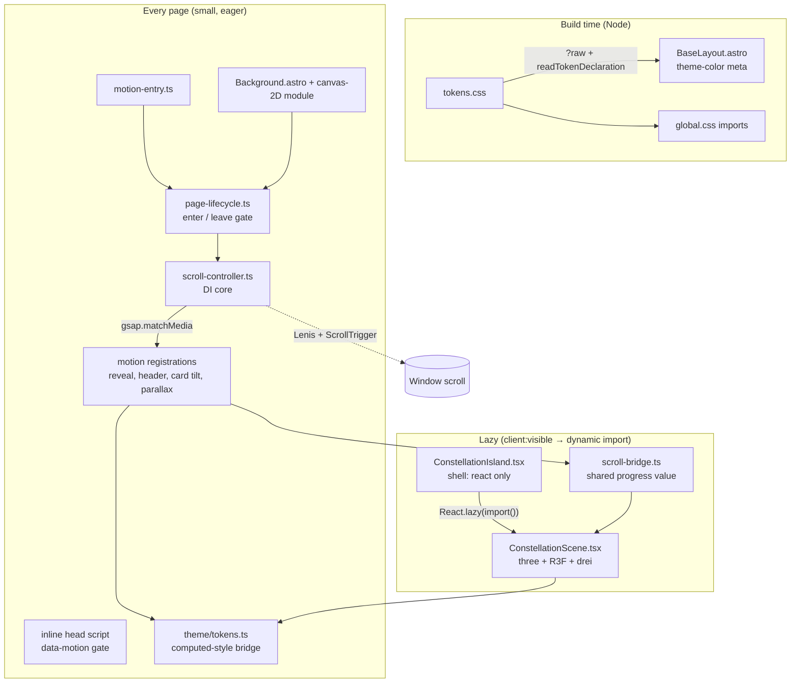
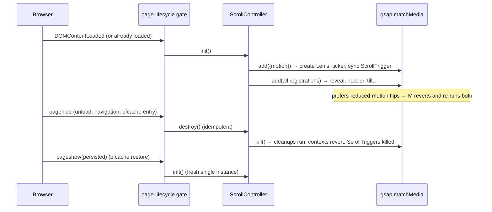

# Design Document

## Overview

This design turns `requirements.md` into a buildable plan for the Naruka AI Labs Astro 7 site (static output, no SSR, no router). It is grounded in the code as it exists today, not in the reference files alone. The main moves:

1. One **Scroll_Controller** (Lenis driven by the GSAP ticker, synced to ScrollTrigger) plus a small **motion registry**, all built on `gsap.matchMedia()` so reduced motion, mobile and live preference changes are handled in one place.
2. A **page lifecycle gate** that makes every init/cleanup idempotent, so React strict mode, bfcache restores and `ClientRouter` swaps (added in Phase 3) cannot leak or duplicate anything.
3. A **token bridge** that resolves Design_Tokens at runtime for JavaScript and Three.js, so no colour literal ever enters a script.
4. One lazily loaded **React island** for the hero Particle_Constellation. `three`, `@react-three/fiber` and `@react-three/drei` sit behind a dynamic `import()` and never reach the initial payload.
5. A typed, bundled **canvas-2D Background_Component** that replaces the vendored `particles.js`.
6. Restyled Navbar, Footer, Button, Card per `GSAP.md`, applying the resolved decisions: no card box-shadow, outlined pills everywhere (gradient-stroke primary) with one filled hero CTA, and Inter Tight for all text.
7. A transform-only port of the sign-in card.
8. Scripted verification (source scans, `dist/` scans, `node:test` logic tests) with no new test dependency.

### What the repo looks like today (findings that shape the design)

| # | Finding | Design consequence |
|---|---------|--------------------|
| F1 | `package.json` has only `astro@^7.3.8` and dev deps `@astrojs/check`, `typescript` (5.9.3). No lockfile-pinned animation or React packages. | Phase 1 installs everything with exact versions. |
| F2 | Today the site is a **multi-page site with no `ClientRouter`/view transitions** (no match for `ClientRouter`, `astro:page-load`, `astro:before-swap` in `src/`). Navbar, Card, Contact and HeroPrism listen for `astro:after-swap`, which never fires until a `ClientRouter` exists. | **Phase 1 and 2:** "navigation" is a real page unload, so the gate's primary path is `pagehide`/`pageshow`. The gate already also handles `astro:before-swap` (leave) and `astro:after-swap` (enter), so adding the router changes no gate code. **Phase 3:** `ClientRouter` is added to `BaseLayout` (user decision, 2026-10-10). From then on `astro:before-swap` (leave) and `astro:after-swap` (enter) are the primary navigation path, `pagehide`/`pageshow` remain for real unload and bfcache, and `astro:page-load` is not used (it would duplicate the first-load enter). Bundled module scripts run once per full page load under a router, so every existing inline script is audited and adapted (section 15). Phase 1 must NOT add `ClientRouter`. |
| F3 | `global.css` sets `html { scroll-behavior: smooth }`. | Lenis needs native smooth scrolling off while it runs. Import `lenis/dist/lenis.css`, which sets `scroll-behavior: auto !important` on `.lenis.lenis-smooth`. |
| F4 | `global.css` already has a CSS `animation-timeline: view()` reveal on `main .section-heading, .glass-panel, .card`. | It would fight a GSAP reveal on the same elements. Phase 1 removes it and replaces it with the GSAP reveal behind a no-flash gate (section "Motion gate"). |
| F5 | `Navbar.astro` locks scroll with `document.body.style.overflow = 'hidden'`. Lenis ignores that. | Navbar uses a ref-counted `scrollLock` that calls `lenis.stop()/start()`. The drawer panel gets `data-lenis-prevent`. |
| F6 | `Background.astro` loads `/vendor/particles.min.js` (vendored, 23 KB) and still carries 9 hex literals (reference gradients and colour sets). `BaseLayout.astro` has one literal: `<meta name="theme-color" content="#1A1D23">`. | Both are baseline violations of R4.2. Background is rewritten (Phase 2); `theme-color` is derived from `tokens.css` at build time (Phase 1). |
| F7 | `signin/index.astro` transitions `left`/`right`/`top`/`bottom` through shorthand `transition: 1s 0.7s ease-in-out` and `transition: all 0.2s 0.7s`; `global.css` has `transition: top` on `.skip-link`. | A shorthand with no property list animates *every* property, so the scanner must treat "no property list" and `all` as layout transitions. These are fixed in Phase 1 (skip link) and Phase 4 (sign-in). |
| F8 | `vercel.json` CSP: `script-src 'self' 'unsafe-inline'; connect-src 'self'; font-src 'self'; img-src 'self' data:`. | Everything must be same-origin. `@react-three/drei` helpers that fetch from a CDN at runtime (`Environment` presets, `Text`/`Text3D` default fonts, remote `useGLTF`/`useTexture`) are **banned** and scanned for. |
| F9 | `HeroPrism.astro` is a hand-written WebGL shader quad with a CSS poster layer, an `IntersectionObserver`, a 45 fps cap and a rolling frame-time guard. | Its patterns (poster first, token RGB read, pause offscreen, guard) carry over. The component is superseded in Phase 3. |
| F10 | `GSAP.md` is a style reference. It gives **no durations, easings or stagger values**. `hero_section.md` gives none either. | R6.10 cannot be satisfied literally. See assumption A1: motion defaults come from `tokens.css` and live in one config file. |
| F11 | `GSAP.md` says "never fill buttons, no box-shadow, Mori font, curly-bracket eyebrows". These were Open_Decisions 1-3 in the requirements. | **Resolved 2026-10-10:** no card box-shadow (OD1), outlined pills with a gradient-stroke primary and one filled hero CTA (OD2), Inter Tight for all text, self-hosted (OD3). See "Resolved decisions" below. |
| F12 | `refrence/` is git-ignored ("local-only, not committed"). `CONTACT_PAGE.jpg` is no longer there; `refrence/contact_page.png` (131 KB) is. | R2.4 cannot be checked with `git diff`. Phase 1 records SHA-256 hashes of the reference files and later phases compare against them. |
| F13 | The earlier spec `usability-consistency-fixes` (completed) limits `src/**/*.astro` to **10 distinct font sizes** and bans raw px radii. A search of `scripts/`, `.github/`, `.githooks/`, `tests/` and `package.json` finds **no script, test or CI step that enforces the size limit**; it lives only in that spec's documents (`requirements.md` criterion 1.2, `design.md` Property 2 with its PowerShell scan snippet, `tasks.md` task 1.6) and is run by hand. | **User decision 2026-10-10:** the cap is lifted for display sizes only, via up to 3 Display_Tokens (section 14). Body and UI text keep the cap of 10. Phase 1 amends the old spec's three documents so the check excludes the Display_Tokens, and the new `verify-source` enforces the split cap. New radii still use `--radius-*` tokens. |
| F14 | `@types/node` is not installed. Node here is 24.14.1 (type stripping on); CI uses Node 22; Astro 7 needs ≥ 22.12. | Logic tests are `.mjs` files that import `.ts` modules directly, so no `@types/node` and no test runner is needed. |
| F15 | `tsconfig.json` extends `astro/tsconfigs/strict`, which already sets `allowImportingTsExtensions`, `verbatimModuleSyntax`, `isolatedModules`, `noEmit`. | `.ts` extension imports and `import type` are the house style for the new modules. |
| F16 | `three@0.186.1` ships no types. `@types/three` is not in Approved_Packages and not exempted by R5.8. | **Resolved 2026-10-10:** the user approved `@types/three` as a dev dependency (assumption A2). No ambient `declare module 'three'` fallback is created. |
| F17 | Font families are set through `--font-display` (Plus Jakarta Sans), `--font-body` (Inter) and `--font-mono` (JetBrains Mono) in `src/styles/tokens.css`; `fonts.css` declares 8 faces from `public/fonts/*.woff2`; `BaseLayout.astro` preloads `inter-400.woff2` and `plus-jakarta-sans-700.woff2`. There is **no size-adjusted fallback face** today. `setu/index.astro` uses `font-family="var(--font-display)"` in an SVG. | Changing every font means editing the three family tokens in `tokens.css` (a non-colour exception to "tokens.css unchanged"), `fonts.css` and the layout preloads. Section 13 covers it. A size-adjusted fallback is new work, not something to "keep". |

Registry versions checked on the design date: `gsap 3.15.0`, `lenis 1.3.26`, `three 0.186.1`, `@react-three/fiber 9.8.1`, `@react-three/drei 10.7.9`, `@astrojs/react 7.0.1`, `react`/`react-dom 19.3.0`, `@types/react`/`@types/react-dom 19.3.0`, `@types/three 0.186.0` (approved), `@fontsource-variable/inter-tight 5.3.0` and `@fontsource/inter-tight 5.3.0`. R3F 9.8.1 needs `react >=19 <19.4`, which 19.3.0 satisfies. Re-run `npm view` in Phase 1 and pin whatever is current, exact.

## Architecture



**Layering rule.** Modules under `src/lib/**` that hold logic are written so they can be imported by `node` without a DOM: they take their dependencies (Lenis factory, GSAP ticker, matchMedia, `getComputedStyle`) as arguments and use `import type` only for third-party types. The thin wiring files (`src/lib/scroll/index.ts`, `src/lib/motion/index.ts`, the TSX files) import the real libraries. This is what makes the logic testable without a browser, and it is the reason the property tests in the Testing Strategy are cheap.

**Sequence: page life.**



## Components and Interfaces

### 1. Page lifecycle gate (`src/lib/lifecycle/page-lifecycle.ts`)

A tiny state machine plus event binding. The machine is pure; the binding takes its event target as an argument.

```ts
export type Cleanup = () => void;
export type Setup = () => void | Cleanup;

export interface Gate {
  enter(): void;     // runs setup once; no-op while active
  leave(): void;     // runs cleanup once; no-op while inactive
  readonly active: boolean;
}

export function createGate(setup: Setup): Gate {
  let cleanup: Cleanup | null = null;
  let active = false;
  return {
    enter() {
      if (active) return;
      active = true;
      cleanup = setup() ?? null;
    },
    leave() {
      if (!active) return;
      active = false;
      const run = cleanup;
      cleanup = null;
      run?.();
    },
    get active() { return active; },
  };
}

export interface LifecycleTarget {
  readonly document: Pick<Document, 'readyState' | 'addEventListener' | 'removeEventListener'>;
  readonly window: Pick<Window, 'addEventListener' | 'removeEventListener'>;
}

/** Binds a gate to page events. Returns an unbind function. */
export function bindPageLifecycle(gate: Gate, target: LifecycleTarget): () => void {
  const enter = () => gate.enter();
  const leave = () => gate.leave();
  const onPageShow = (e: Event) => { if ((e as PageTransitionEvent).persisted) gate.enter(); };

  if (target.document.readyState === 'loading') {
    target.document.addEventListener('DOMContentLoaded', enter, { once: true });
  } else {
    gate.enter();
  }
  target.window.addEventListener('pagehide', leave);
  target.window.addEventListener('pageshow', onPageShow);
  // Router events. Inert until the ClientRouter is added in Phase 3, so Phase 1 needs no change when it arrives.
  target.document.addEventListener('astro:before-swap', leave);   // old page is about to be replaced: tear down
  target.document.addEventListener('astro:after-swap', enter);    // new page is in the DOM: initialise once
  // 'astro:page-load' is deliberately NOT bound: under a router it also fires on the first load,
  // right after the DOMContentLoaded/immediate enter above, which would be a duplicate entry.

  return () => {
    target.document.removeEventListener('DOMContentLoaded', enter);
    target.window.removeEventListener('pagehide', leave);
    target.window.removeEventListener('pageshow', onPageShow);
    target.document.removeEventListener('astro:before-swap', leave);
    target.document.removeEventListener('astro:after-swap', enter);
  };
}
```

Why this shape:

- `enter` while active and `leave` while inactive are no-ops, so double init (strict mode, a bfcache `pageshow` that follows a swap, a repeated `astro:after-swap`) and double teardown are harmless (R6.7). The gate stays idempotent however the events interleave.
- `pagehide` fires for both real unload and bfcache entry; `pageshow` with `persisted` re-enters on restore. Without this pair, a bfcache restore would resume a page whose Lenis was already destroyed. These two remain the unload and bfcache path even after the router arrives.
- `astro:before-swap` (leave) and `astro:after-swap` (enter) are the primary navigation path from Phase 3. The first load under a router fires no `astro:after-swap`, so the initial entry comes only from the DOMContentLoaded or immediate branch. `astro:page-load` would fire on that first load as well, which is why `astro:after-swap` is used for re-entry. (Phase 1 and 2 never see either router event, because there is no router yet.)
- Under a router the `document` and `window` objects survive a swap, so these listeners are registered once for the whole session by the bundled module script. The page DOM is replaced, which is why every effect that holds element references must rebuild in `enter` (the Scroll_Controller does, because each `init` re-runs every registration and re-selects its elements).

React islands do not use this gate. They use React effect cleanup (section 7) and are written to survive the strict-mode mount → cleanup → mount sequence.

### 2. Scroll_Controller (`src/lib/scroll/scroll-controller.ts`)

Dependency-injected core; no value imports of `gsap`, `lenis`, `three`.

```ts
export interface LenisLike {
  on(event: 'scroll', cb: () => void): unknown;
  raf(timeMs: number): void;
  start(): void;
  stop(): void;
  destroy(): void;
}
export interface TickerLike {
  add(cb: (timeSeconds: number) => void): unknown;
  remove(cb: (timeSeconds: number) => void): unknown;
  lagSmoothing(threshold?: number, adjustedLag?: number): unknown;
}
export interface TriggerLike { kill(revert?: boolean): void }
export interface ScrollTriggerLike {
  update(): void;
  refresh(): void;
  getAll(): TriggerLike[];
}
export type Conditions = Readonly<Record<string, boolean>>;
export interface MatchMediaLike {
  add(
    queries: Readonly<Record<string, string>>,
    setup: (ctx: { conditions?: Conditions }) => void | (() => void),
  ): unknown;
  kill(): void;
}

export interface ScrollControllerDeps {
  registerPlugins(): void;          // guarded: registers ScrollTrigger (+ CustomEase) once per module
  createLenis(): LenisLike;
  createMatchMedia(): MatchMediaLike;
  ticker: TickerLike;
  scrollTrigger: ScrollTriggerLike;
}

export interface MotionFlags {
  readonly fullMotion: boolean;     // prefers-reduced-motion: no-preference
  readonly reduced: boolean;        // prefers-reduced-motion: reduce
  readonly mobile: boolean;         // width < 768  → (max-width: 767.98px)
  readonly desktop: boolean;        // width >= 768
  readonly finePointer: boolean;    // (hover: hover) and (pointer: fine)
}
export type MotionSetup = (flags: MotionFlags) => void | (() => void);

export interface ScrollController {
  init(): void;                                     // idempotent
  destroy(): void;                                  // idempotent
  register(key: string, setup: MotionSetup): void;  // survives destroy/init cycles; same key replaces
  lock(reason: string): () => void;                 // ref-counted; returns release (idempotent)
  readonly running: boolean;
  readonly stats: { lenis: number; tickerCallbacks: number };   // for tests / DEV only
}
```

Behaviour (the part that matters):

```ts
init() {
  if (mm) return;                                   // R6.7: second init leaves exactly one instance
  deps.registerPlugins();                           // R6.2: once
  mm = deps.createMatchMedia();

  // Lenis lives only while motion is allowed (R7.4, R7.5). Own query set, so a resize across 768px does not rebuild it.
  mm.add({ fullMotion: '(prefers-reduced-motion: no-preference)' }, (ctx) => {
    if (!ctx.conditions?.fullMotion) return;        // reduced → native scrolling, no Lenis
    const instance = deps.createLenis();            // R6.1
    const tick = (t: number) => instance.raf(t * 1000);   // R6.4: GSAP ticker owns the frame
    instance.on('scroll', () => deps.scrollTrigger.update()); // R6.3
    deps.ticker.add(tick);
    deps.ticker.lagSmoothing(0);
    lenis = instance;
    applyLock();
    return () => {
      deps.ticker.remove(tick);
      deps.ticker.lagSmoothing(500, 33);            // restore GSAP defaults
      instance.destroy();
      if (lenis === instance) lenis = null;
    };
  });

  // Every registered effect runs in its own matchMedia context, so GSAP reverts tweens and ScrollTriggers for us.
  for (const [key, setup] of registrations) addRegistration(key, setup);
}

destroy() {
  if (!mm) return;
  mm.kill();                                        // runs cleanups, reverts contexts
  mm = null;
  for (const t of deps.scrollTrigger.getAll()) t.kill();   // R6.5 backstop for anything created outside a context
  lenis = null;
}
```

Real wiring (`src/lib/scroll/index.ts`):

```ts
import gsap from 'gsap';
import { ScrollTrigger } from 'gsap/ScrollTrigger';
import { CustomEase } from 'gsap/CustomEase';
import Lenis from 'lenis';
import 'lenis/dist/lenis.css';
import { createScrollController } from './scroll-controller.ts';

let pluginsRegistered = false;

export const scrollController = createScrollController({
  registerPlugins() {
    if (pluginsRegistered) return;
    gsap.registerPlugin(ScrollTrigger, CustomEase);
    ScrollTrigger.config({ ignoreMobileResize: true });
    pluginsRegistered = true;
  },
  createLenis: () => new Lenis({ autoRaf: false, lerp: 0.1, smoothWheel: true, anchors: false, syncTouch: false }),
  createMatchMedia: () => gsap.matchMedia(),
  ticker: gsap.ticker,
  scrollTrigger: ScrollTrigger,
});
```

Decisions inside this snippet:

- `autoRaf: false` plus `gsap.ticker.add` is the documented way to give GSAP the single clock. `lagSmoothing(0)` stops GSAP from compressing time after a long frame, which would make Lenis stutter.
- `anchors: false`. With Lenis anchor handling on, the `#main-content` skip link would scroll but not move keyboard focus (R9.3). Native anchor jumping stays.
- `syncTouch: false`. Touch devices keep native momentum scrolling. Lenis only smooths wheel/trackpad.
- After fonts load, `document.fonts.ready.then(() => scrollTrigger.refresh())` runs inside `init`, guarded by "still the same init generation", so layout shifts from font swap do not leave triggers misaligned.
- The ScrollTrigger plugin and `CustomEase` register once per module instance (`pluginsRegistered`). `gsap.registerPlugin` itself tolerates repeats, but the flag keeps R6.2 provable.
- In development only, `globalThis.__narukaMotionStats` returns `scrollController.stats` plus `ScrollTrigger.getAll().length`. Phase 5 uses it to check leaks. It is behind `import.meta.env.DEV` and absent from production bundles.

**Scroll lock.** `lock(reason)` adds a `Symbol` to a set and calls `lenis.stop()`; its release removes the symbol and calls `lenis.start()` when the set is empty. Rule: Lenis is stopped **iff** the set is non-empty. The Navbar drawer acquires on open and releases on close, and keeps its existing `body.style.overflow` line as the no-Lenis path (reduced motion).

### 3. Motion layer (`src/lib/motion/`)

Files: `config.ts`, `guard.ts`, `plan.ts`, `reveal.ts`, `index.ts` (registers built-ins).

**3.1 Conditions.**

```ts
export const MOTION_QUERIES = {
  fullMotion: '(prefers-reduced-motion: no-preference)',
  reduced: '(prefers-reduced-motion: reduce)',
  mobile: '(max-width: 767.98px)',
  desktop: '(min-width: 768px)',
  finePointer: '(hover: hover) and (pointer: fine)',
} as const;
```

`gsap.matchMedia().add(queries, fn)` re-runs `fn` and reverts the previous run whenever any listed query changes. That is how R7.5 (live switch, no reload) works for every registered effect without extra code. Mobile is `< 768px` to match R-Glossary and the Navbar's `min-width: 768px` desktop breakpoint.

**3.2 What each mode is allowed to do** (R7):

| Concern | `fullMotion` | `reduced` |
|---|---|---|
| Smooth scroll | Lenis | none, native scroll |
| Reveal | opacity + `y` 24 → 0, batched stagger | opacity 0 → 1 only, 0.2 s, no stagger |
| Pin / scrub | allowed (desktop parallax only) | **none created** |
| Card tilt, header effects | on (fine pointer only) | off |
| Scene_3D | animated | one static frame |
| Background canvas | animated | one static frame |

**3.3 Composited-only guard (R6.8, R6.9).**

```ts
// guard.ts
const COMPOSITED = new Set([
  'opacity', 'autoAlpha', 'x', 'y', 'z', 'xPercent', 'yPercent', 'scale', 'scaleX', 'scaleY',
  'rotation', 'rotationX', 'rotationY', 'rotationZ', 'skewX', 'skewY', 'transformPerspective', 'transformOrigin',
]);
const CONTROL = new Set([
  'duration', 'delay', 'ease', 'stagger', 'overwrite', 'immediateRender', 'onComplete', 'onStart', 'onUpdate',
  'paused', 'repeat', 'yoyo', 'clearProps', 'force3D', 'scrollTrigger',
]);
export function findNonComposited(vars: Readonly<Record<string, unknown>>): string[] {
  return Object.keys(vars).filter((k) => !COMPOSITED.has(k) && !CONTROL.has(k));
}
```

Every `gsap.to/from/fromTo/set` in `src/lib/motion/**` goes through `tween(vars)` helpers that call `findNonComposited` and, in development, throw on a hit. `autoAlpha` is allowed because it only adds `visibility`, which is not a Layout_Property. The source scan (section "Testing Strategy") is the second line of defence.

**3.4 Defaults and where they come from (assumption A1).**

`GSAP.md` carries no numbers, so `config.ts` derives them from tokens that already exist in `tokens.css`, read once per `fullMotion` run:

| Use | Token / value |
|---|---|
| Reveal duration | `--motion-duration-slower` (600 ms) |
| Reveal ease | `--ease-out` `cubic-bezier(0.23, 1, 0.32, 1)` → `CustomEase.create('naruka-out', '0.23,1,0.32,1')` |
| Reveal distance | 24 px (`--space-6`) |
| Stagger | 0.08 s between items of a batch |
| Start line | `top 88%`, `once: true` |
| Reduced fade | 0.2 s, constant (the CSS tokens collapse to 0.01 ms under reduce, which would skip the fade) |

Tokens come in as CSS strings, so `parseDurationToken('600ms') → 0.6` and `parseCubicBezier('cubic-bezier(…)') → [a, b, c, d]` are pure helpers with tests. If the user later supplies real values, only `config.ts` changes.

**3.5 Reveal plan.** `planReveal(flags, tokens): RevealPlan` is pure and returns the tween vars and ScrollTrigger options; `reveal.ts` applies them.

```ts
export interface RevealPlan {
  readonly from: { opacity: number; y?: number };
  readonly to: { opacity: number; y?: number; duration: number; ease: string; stagger?: number };
  readonly trigger: { start: string; once: true; scrub?: never; pin?: never };
}
```

`reveal.ts` exports a registration factory that takes the `MotionApi` facade (section 3.8) and registers once under key `reveal`:

```ts
export function revealRegistration(api: MotionApi, tokens: () => MotionTokens): MotionSetup {
  return (flags) => {
    const items = api.select(REVEAL_SELECTOR);      // 'main :is(.section-heading, .glass-panel, .card), [data-reveal]'
    if (items.length === 0) return;
    const plan = planReveal(flags, tokens());
    api.set(items, plan.from);
    api.batch(items, {
      start: plan.trigger.start,
      once: true,
      onEnter: (batch) => api.to(batch, { ...plan.to, overwrite: true }),
    });
    api.setMotionState('ready');
  };
}
// motion/index.ts: scrollController.register('reveal', revealRegistration(realMotionApi, readMotionTokens));
```

`REVEAL_SELECTOR` mirrors the CSS selector being removed (F4), so pages need no edits for baseline reveals. `ScrollTrigger.batch` creates one trigger group for the whole page and staggers items that enter together, which is cheaper than one trigger per card.

**3.6 Motion gate (no flash, CLS 0).** Hiding elements in JavaScript after first paint flashes content. Hiding them in CSS with no escape hatch hides content forever if the script fails. The gate is a three-state attribute:

```html
<!-- BaseLayout.astro, <head>, before any stylesheet paints -->
<script is:inline>
  (function () {
    var root = document.documentElement;
    root.setAttribute('data-motion', 'pending');
    setTimeout(function () {
      if (root.getAttribute('data-motion') === 'pending') root.setAttribute('data-motion', 'failed');
    }, 2500);
  })();
</script>
```

```css
/* global.css */
html[data-motion='pending'] :is(main .section-heading, main .glass-panel, main .card, [data-reveal]) {
  opacity: 0;
}
```

When `reveal` has run `gsap.set(items, from)` the inline styles now hold the hidden state, and `setMotionState('ready')` lifts the CSS rule with no visible change. On `destroy` the state goes to `off` and the context revert clears inline styles, so a page restored from bfcache is fully visible. If the script never arrives, the timer flips to `failed` after 2.5 s and the content shows. No JS at all means the attribute is never set, so nothing is hidden. Opacity and transform do not affect layout, so the gate adds no layout shift (R9.1). The inline script is allowed by the current CSP (`'unsafe-inline'`).

**3.7 Other registrations.**

- `header`: toggles `data-scrolled` on `#site-header` via a ScrollTrigger (`start: 'top -8'`, `onToggle`). CSS fades a background layer (`opacity` transition). No layout properties.
- `parallax` (desktop + fullMotion): elements with `data-parallax="0.15"` get a scrubbed `yPercent` tween. This is the only scrubbed trigger family and it never exists under reduced motion.
- `scene-progress`: a scrubbed trigger on the hero section writes `0..1` into `scroll-bridge.ts` (section 8). Desktop + fullMotion only.
- `card-tilt`: section 10.4.

**3.8 Testability seam (`MotionApi`).** Registrations never import `gsap` or `ScrollTrigger` themselves. They receive a small facade, which is what lets scripted tests run every built-in registration against a recorder and assert what it would animate (sections "Testing Strategy" and Properties 3 and 4).

```ts
// src/lib/motion/api.ts — types and pure helpers only; no value import of gsap
export type TweenVars = Readonly<Record<string, unknown>>;
export interface TriggerOptions {
  readonly trigger?: Element | string;
  readonly start?: string;
  readonly end?: string;
  readonly once?: boolean;
  readonly scrub?: boolean | number;
  readonly pin?: boolean | Element | string;
  readonly onToggle?: (active: boolean) => void;
  readonly onEnter?: (targets: Element[]) => void;
}
export interface MotionApi {
  select(selector: string): HTMLElement[];
  set(targets: Element[], vars: TweenVars): void;
  to(targets: Element[], vars: TweenVars): void;
  fromTo(targets: Element[], from: TweenVars, to: TweenVars): void;
  quickTo(target: Element, prop: string, vars: TweenVars): (value: number) => void;
  trigger(options: TriggerOptions): void;                                  // single ScrollTrigger
  batch(targets: Element[], options: TriggerOptions): void;                // ScrollTrigger.batch
  setMotionState(state: 'pending' | 'ready' | 'failed' | 'off'): void;
}
```

`src/lib/motion/real-api.ts` implements it with `gsap` and `ScrollTrigger`, routing `set/to/fromTo/quickTo` through `findNonComposited` (3.3). The recorder used by tests implements the same interface and stores every call, so "which properties were animated, was anything pinned or scrubbed" becomes a plain data assertion.

### 4. Token bridge (`src/lib/theme/`)

**Problem.** `getComputedStyle(root).getPropertyValue('--primary')` returns the *authored text* of an unregistered custom property: `#34A85A` for palette tokens, but the literal string `color-mix(in srgb, …)` for derived ones such as `--surface-2`. `HeroPrism` avoided this by reading the `--*-rgb` triplets, but `--text` and `--text-muted` have none.

**Solution.** Resolve through the browser: put a probe element in the document with `color: var(--token)` and read its *used* `color`. The browser flattens `color-mix()` and `var()` for us.

```ts
// color.ts — pure
export interface Rgb { readonly r: number; readonly g: number; readonly b: number }   // 0..1, sRGB
export interface Rgba extends Rgb { readonly a: number }

/** Parses what getComputedStyle().color can return: rgb(), rgba(), color(srgb …), with comma or space syntax. */
export function parseCssColor(input: string): Rgba | null { /* … */ }
export function formatRgb(c: Rgba): string { /* rgb(r g b / a) with 0..255 integers */ }
```

```ts
// tokens.ts — thin, takes a root element
export type TokenName = `--${string}`;
export function createTokenReader(doc: Document) {
  const cache = new Map<TokenName, Rgba>();
  const probe = doc.createElement('span');
  probe.setAttribute('aria-hidden', 'true');
  probe.style.cssText = 'position:absolute;visibility:hidden;pointer-events:none';
  return {
    color(name: TokenName): Rgba {
      const hit = cache.get(name);
      if (hit) return hit;
      probe.style.color = `var(${name})`;
      doc.documentElement.appendChild(probe);
      const parsed = parseCssColor(getComputedStyle(probe).color);
      probe.remove();
      if (!parsed) throw new Error(`Design token ${name} did not resolve to a colour`);
      cache.set(name, parsed);
      return parsed;
    },
    invalidate() { cache.clear(); },
  };
}
```

The probe's `position:absolute;visibility:hidden` is inline layout styling and contains no colour literal. A missing token yields `rgb(0,0,0)` from the inherited colour; to catch that, `color(name)` first checks `getPropertyValue(name).trim() !== ''` and throws a named error otherwise.

**Three.js adapter** (only inside the lazy chunk): `new Color().setRGB(r, g, b, SRGBColorSpace)`. Passing the colour space matters: with colour management on, plain `setRGB` assumes linear and washes colours out. Custom shaders end with `#include <colorspace_fragment>` so output matches the CSS colour.

**Build-time token read.** `BaseLayout.astro` needs a literal for `<meta name="theme-color">` (HTML attributes cannot read CSS variables). Instead of a literal in the component:

```astro
---
import tokensCss from '../styles/tokens.css?raw';
import { readTokenDeclaration } from '../lib/theme/token-file.ts';
const themeColor = readTokenDeclaration(tokensCss, '--bg');   // throws if the value is not a plain literal
---
<meta name="theme-color" content={themeColor} />
```

`readTokenDeclaration(css, name)` returns the first `name: value;` in `:root` and throws if the value contains `var(` or `color-mix(`. Result: no colour literal in any component, and the meta tag can never drift from `--bg` (this replaces the "keep in sync" comment in the layout).

### 5. Lazy React island pattern

**Rules (R5.4, R8.1, R8.2, R8.10):**

1. Only `*.tsx` files under `src/components/scene/` are React. Everything else stays Astro.
2. The island *shell* imports React and tiny pure helpers only. `three`, `@react-three/fiber`, `@react-three/drei` are reachable **only** through `import()`.
3. The shell renders the same markup on the server and on first client render (the poster), then upgrades in an effect. No hydration mismatch, so no console warning (R9.2).
4. The poster lives in the Astro wrapper, outside the island. If the island never loads, nothing on the page changes.

**Astro side.**

```astro
---
// Scene3D.astro — reserves space, hosts the poster, labels the region for assistive tech
interface Props {
  decorative?: boolean;       // default true → aria-hidden
  label?: string;             // required when decorative is false
  class?: string;
}
const { decorative = true, label, class: className = '' } = Astro.props;
---
<div
  class={`scene ${className}`}
  data-scene-state="poster"
  aria-hidden={decorative ? 'true' : undefined}
  role={decorative ? undefined : 'img'}
  aria-label={decorative ? undefined : label}
>
  <slot name="poster" />
  <div class="scene-layer"><slot /></div>
</div>

<style>
  .scene { position: relative; aspect-ratio: var(--scene-aspect, 1 / 1); width: 100%; contain: layout paint; }
  .scene-layer { position: absolute; inset: 0; opacity: 0; transition: opacity var(--transition-slow); }
  .scene[data-scene-state='live'] .scene-layer { opacity: 1; }
</style>
```

`aspect-ratio` plus `contain: layout paint` reserves the box before any script runs (R9.1). The canvas fades in with `opacity` only. The island sets `data-scene-state` on its closest `.scene` (`live`, `poster`, or `failed`) through a ref callback so the Astro CSS can react.

Usage in the hero:

```astro
<Scene3D class="hero-scene">
  <ScenePoster slot="poster" />
  <ConstellationIsland client:visible={{ rootMargin: '200px' }} />
</Scene3D>
```

**React shell.**

```tsx
// ConstellationIsland.tsx
import { Component, lazy, Suspense, useEffect, useState, type ReactNode } from 'react';
import { selectQuality, type QualityProfile, type SceneEnvironment } from '../../lib/scene/quality.ts';
import { detectWebGL } from '../../lib/scene/webgl-support.ts';
import { whenIdle } from '../../lib/scene/idle.ts';

const ConstellationScene = lazy(() => import('./ConstellationScene.tsx'));

type Phase =
  | { kind: 'checking' }
  | { kind: 'poster'; reason: 'save-data' | 'low-memory' | 'no-webgl' | 'error' }
  | { kind: 'scene'; quality: QualityProfile };

export default function ConstellationIsland(): ReactNode {
  const [phase, setPhase] = useState<Phase>({ kind: 'checking' });

  useEffect(() => {
    const reduce = window.matchMedia('(prefers-reduced-motion: reduce)');
    const narrow = window.matchMedia('(max-width: 767.98px)');
    let cancelled = false;

    const evaluate = () => {
      const quality = selectQuality(readEnvironment(reduce.matches, narrow.matches));
      if (quality.tier === 'poster') return setPhase({ kind: 'poster', reason: quality.posterReason });
      if (!detectWebGL(document)) return setPhase({ kind: 'poster', reason: 'no-webgl' });
      setPhase({ kind: 'scene', quality });
    };

    const cancelIdle = whenIdle(() => { if (!cancelled) evaluate(); }, 1500);   // keep LCP and TBT clear
    reduce.addEventListener('change', evaluate);                                // R7.5: static ⇄ animated without reload
    narrow.addEventListener('change', evaluate);
    return () => {
      cancelled = true;
      cancelIdle();
      reduce.removeEventListener('change', evaluate);
      narrow.removeEventListener('change', evaluate);
    };
  }, []);

  if (phase.kind !== 'scene') return null;                      // server + first client render: nothing, poster shows
  return (
    <SceneBoundary>
      <Suspense fallback={null}>
        <ConstellationScene quality={phase.quality} />
      </Suspense>
    </SceneBoundary>
  );
}
```

`SceneBoundary` is a class component with `componentDidCatch` that marks the nearest `.scene` as `failed` and renders `null`. A failed dynamic import (offline, chunk 404) rejects `lazy`, lands in the boundary, and the page stays intact (R8.10). Logging is `console.debug` under `import.meta.env.DEV` only.

**Why `client:visible` and not `client:only`.** `client:visible` still server-renders the shell (empty) and defers *downloading* the island JS until the placeholder nears the viewport. A hero above the fold becomes visible immediately, so the shell downloads at load but off the critical path; the heavy chunk is a second hop that also waits for `whenIdle`. `rootMargin: '200px'` starts fetching just before an offscreen scene scrolls in.

**Bundle shape.** `three` is imported by name (`import { Color, AdditiveBlending, … } from 'three'`), never `import * as THREE`, so unused classes tree-shake. From drei, only `PerformanceMonitor` is allowed. No manual chunking in Phase 1; revisit in Phase 5 only if the measured payload demands it.

### 6. Particle_Constellation

**6.1 Look (from `hero_section.md`, adapted).** A brain-shaped cloud of small outlined triangles in several hues, plus sparse ambient triangles drifting at low opacity. No lines in the reference's description, but Requirement 12.1/Glossary asks for "particle field and connecting lines", so a thin web of lines joins close neighbours. Hues come from tokens only: `--accent`, `--primary`, `--secondary`, `--text` (the four "chromatic + bone" slots replace Electric Iris / Saffron / Verdant / Bone White).

**6.2 Data model (pure, `src/lib/scene/`).**

```ts
// prng.ts
export function mulberry32(seed: number): () => number;   // [0, 1), deterministic

// brain-field.ts
export const PALETTE_SIZE = 4;                    // index → token: 0 accent, 1 primary, 2 secondary, 3 text
export interface FieldConfig {
  readonly seed: number;
  readonly brainCount: number;
  readonly ambientCount: number;
  readonly ambientRadius: number;                 // outer bound for ambient points
}
export interface ParticleField {
  readonly count: number;                         // brainCount + ambientCount
  readonly positions: Float32Array;               // xyz × count
  readonly sizes: Float32Array;                   // px at reference distance
  readonly phases: Float32Array;                  // twinkle phase 0..2π
  readonly colorIndex: Uint8Array;                // 0..PALETTE_SIZE-1
  readonly ambient: Uint8Array;                   // 1 for ambient points
}
export const BRAIN_BOUND = 1.4;
export function generateField(cfg: FieldConfig): ParticleField;
```

`generateField` is deterministic for a given config. Brain sampling: for each hemisphere (centre `x = ±0.09`) draw a direction from seeded Gaussians, push the radius toward the surface (`r = 1 - 0.35·u³`) so the silhouette reads as an outline, scale by ellipsoid axes `(0.95, 0.8, 0.72)`, add a gyri displacement `0.05·(sin 7x + sin 6y + sin 5z)`, then widen the longitudinal fissure by nudging points with `|x| < 0.04` outward. About 12% of the points go to a small cerebellum lobe (lower back) and a stem. Ambient points fill the spherical shell between `1.2` and `ambientRadius`. Final visual tuning is an implementation task; the invariants (count, bounds, palette range, determinism) are what the tests pin.

```ts
// links.ts
export interface LinkConfig { readonly distance: number; readonly maxLinks: number; readonly maxDegree: number }
/** Returns packed index pairs [i0, j0, i1, j1, …] with i < j. Deterministic. */
export function buildLinks(positions: Float32Array, count: number, cfg: LinkConfig): Uint32Array;
```

`buildLinks` uses a uniform grid with cell size `distance` so each point only checks its 27 neighbouring cells. It iterates `i` ascending, stops at `maxLinks`, and skips a pair if either endpoint has reached `maxDegree`. Topology is computed **once** per field because the whole group rotates rigidly (relative distances never change), so there is no per-frame link recomputation. Per-particle twinkle runs in the vertex shader only.

**6.3 Quality profile (pure).**

```ts
export type Tier = 'full' | 'lite' | 'frame' | 'poster';
export interface SceneEnvironment {
  readonly width: number;
  readonly devicePixelRatio: number;
  readonly reducedMotion: boolean;
  readonly saveData: boolean;
  readonly deviceMemoryGb: number | null;
}
export interface QualityProfile {
  readonly tier: Tier;
  readonly posterReason: 'save-data' | 'low-memory' | 'none';
  readonly animate: boolean;
  readonly pointerParallax: boolean;
  readonly dprCap: number;
  readonly field: { brainCount: number; ambientCount: number };
  readonly links: { maxLinks: number; maxDegree: number };
}
export function selectQuality(env: SceneEnvironment): QualityProfile;
export function degrade(q: QualityProfile): QualityProfile;      // used by PerformanceMonitor decline
```

| Tier | When | Brain + ambient | Max links | DPR cap | Animates |
|---|---|---|---|---|---|
| `poster` | `saveData`, or `deviceMemory ≤ 2` | 0 (no WebGL, no three download) | 0 | n/a | no |
| `frame` | `reducedMotion` | by width, as below | by width | ≤ 2 | **no** (one frame, no pointer, `t = 0`) |
| `lite` | `width < 768` | 600 + 120 | 500 | ≤ 1.5 | yes, slow rotation only |
| `full` | otherwise | 2400 + 600 | 3000 | ≤ 2 | yes, plus pointer parallax and scroll bridge |

Precedence: `poster` > `frame` > `lite` > `full` for the *animate* decision; counts follow the width (a reduced-motion phone gets the `lite` counts as a still frame). `dprCap = min(devicePixelRatio, tierCap)` and never exceeds 2 (R8.3). `degrade` multiplies counts by 0.6, drops `dprCap` to 1, and turns pointer parallax off. `deviceMemory` and `connection.saveData` are non-standard, so they are read through a typed `Navigator` extension, as `HeroPrism` already does, with no `any`.

The 60 fps target (R8.7) is met by design: at most 3000 `Points` plus one `LineSegments` draw call, no per-frame CPU geometry work, no postprocessing. It is verified in Phase 5 on a reference device and reported, not assumed.

**6.4 Scene (lazy chunk).**

```tsx
// ConstellationScene.tsx — default export, loaded only by dynamic import
import { Canvas, useFrame, useThree } from '@react-three/fiber';
import { PerformanceMonitor } from '@react-three/drei';
import { useEffect, useMemo, useRef, useState } from 'react';
import { AdditiveBlending, Color, SRGBColorSpace, type Group, type ShaderMaterial } from 'three';
import { shouldRun } from '../../lib/scene/run-state.ts';
import { scrollBridge } from '../../lib/scene/scroll-bridge.ts';
```

- `<Canvas frameloop={running ? 'always' : 'demand'} dpr={[1, quality.dprCap]} gl={{ antialias: false, alpha: true, powerPreference: 'high-performance', failIfMajorPerformanceCaveat: true }} camera={{ fov: 45, position: [0, 0, 6] }}>`. `demand` stops the render loop (R8.4, R8.5, R7.1); on resume the component calls `invalidate()` once.
- `failIfMajorPerformanceCaveat: true` makes a software-rendered context fail creation, which is the same path as "WebGL unavailable" (R8.9).
- Geometry is declared in JSX (`<bufferGeometry>`, `<bufferAttribute args={[array, 3]} />`, `<shaderMaterial />`) so R3F disposes it on unmount. Anything built imperatively goes through a `DisposableBag` (section 7).
- Triangle glyphs: a `ShaderMaterial` on `Points`. The vertex shader sets `gl_PointSize` from `aSize`, a perspective term and `uPixelRatio`, and flickers alpha with `aPhase`/`uTime`. The fragment shader draws an outlined triangle from `gl_PointCoord` with a signed-distance function and picks its colour from a `uPalette` array of four `Color`s. The shader strings hold no colour literals.
- Lines: `LineSegments` with a `LineBasicMaterial` (`--secondary`, `opacity ≈ 0.25`, `transparent`, `depthWrite: false`).
- `useFrame`: if not animating, return. Otherwise rotate the group slowly, lerp a pointer offset (fine pointer + `full` only), and add `scrollBridge.progress * 0.6` to the X rotation. No state updates inside `useFrame`.
- `PerformanceMonitor onDecline={() => setQuality(degrade)}` replaces `HeroPrism`'s hand-rolled rolling average.

**6.5 Pause and run state (pure).**

```ts
// run-state.ts
export interface RunInputs {
  readonly ready: boolean;          // first frame produced
  readonly inView: boolean;         // IntersectionObserver on the .scene element
  readonly documentHidden: boolean; // document.visibilityState === 'hidden'
  readonly reducedMotion: boolean;
  readonly contextLost: boolean;
  readonly animate: boolean;        // from the quality profile
}
export function shouldRun(i: RunInputs): boolean {
  return i.ready && i.animate && i.inView && !i.documentHidden && !i.reducedMotion && !i.contextLost;
}
```

An `IntersectionObserver` (threshold 0, `rootMargin: '100px'`) and a `visibilitychange` listener feed `RunInputs`. Both use an `AbortController` signal so a single `abort()` removes every listener.

**6.6 WebGL support and failure handling.**

```ts
// webgl-support.ts
export function detectWebGL(doc: Document): boolean {
  const canvas = doc.createElement('canvas');
  const gl = (canvas.getContext('webgl2', { failIfMajorPerformanceCaveat: true })
    ?? canvas.getContext('webgl', { failIfMajorPerformanceCaveat: true })) as WebGLRenderingContext | null;
  if (!gl || gl.isContextLost()) return false;
  gl.getExtension('WEBGL_lose_context')?.loseContext();   // free the probe context immediately
  return true;
}
```

| Failure | Detection | Result |
|---|---|---|
| No WebGL / software renderer | `detectWebGL` false | `poster` phase, three never downloaded |
| `saveData` / ≤ 2 GB memory | `selectQuality` → `poster` | same |
| Chunk fails to load / render throws | `React.lazy` rejection, `SceneBoundary` | `data-scene-state="failed"`, poster stays, page unaffected |
| Context lost at runtime | `webglcontextlost` on the canvas (`preventDefault()`) | `contextLost` input → loop stops, poster shown; on `webglcontextrestored` the scene resumes |

The poster (`ScenePoster.astro`) is the CSS-only layer lifted from `HeroPrism` (aurora radial gradients, faint flutes, hairline), re-expressed with token variables only.

### 7. Disposal and cleanup

```ts
// disposables.ts
export interface Disposable { dispose(): void }
export function createDisposableBag() {
  const items = new Set<Disposable>();
  return {
    track<T extends Disposable>(item: T): T { items.add(item); return item; },
    disposeAll(): void { for (const item of items) item.dispose(); items.clear(); },   // each exactly once, idempotent
  };
}
```

On unmount (R8.6):

- R3F unmounts the reconciler tree, disposes JSX-created geometries/materials/textures, calls `renderLists.dispose()` and `forceContextLoss()`.
- Resources created imperatively (for example a palette `Color` array is not disposable, but a `ShaderMaterial` made outside JSX is) are `track`ed and released by `disposeAll()` in the effect cleanup.
- Listeners (pointer, `visibilitychange`, `webglcontextlost/restored`, `IntersectionObserver`, `matchMedia` change) share one `AbortController`; the cleanup calls `abort()` and `observer.disconnect()`.
- React strict mode runs mount → cleanup → mount. Every effect above is written so the second mount rebuilds from scratch and the first cleanup leaves nothing behind.

### 8. Scroll bridge (`src/lib/scene/scroll-bridge.ts`)

```ts
export const scrollBridge: { progress: number } = { progress: 0 };
export function setScrollProgress(p: number): void { scrollBridge.progress = Math.min(1, Math.max(0, Number.isFinite(p) ? p : 0)); }
```

A plain mutable object shared by the ScrollTrigger side (writes) and the `useFrame` side (reads). No React state and no re-render. Under reduced motion no scrubbed trigger exists, so `progress` stays `0` and the frame is static (R7.2). Both sides import the same module, so the bundler puts it in a shared chunk; it contains no heavy dependency, so it does not pull `three` into the main payload.

### 9. Background_Component (`src/components/ui/Background.astro` + `src/lib/background/`)

**Goal.** Reproduce the look and behaviour of `background.txt` (140-ish drifting dots, thin links, hover "grab" lines, click "push") with a typed, bundled canvas-2D module, no `particles.js`, no `@ts-ignore`, no hex.

**Config carried over from the reference:** density 140 per 800-unit area, size 1–3 with size animation, opacity 0.3–0.7 with animation, speed 2 with random direction and bounce at the edges, link distance 160 / opacity 0.4 / width 1.2, grab distance 220 with link opacity 0.8, push adds 4 particles.

**Pure module (`particle-field.ts`)**

```ts
export interface Particle { x: number; y: number; vx: number; vy: number; r: number; a: number; dr: number; da: number }
export interface Bounds { readonly width: number; readonly height: number }
export interface BackgroundConfig { densityValue: 140; densityArea: 800; maxCount: number; speed: 2; /* … */ }

export function particleCountForArea(b: Bounds, cfg: BackgroundConfig): number;   // round(w·h/1000 · 140/800), capped
export function createParticles(b: Bounds, count: number, rng: () => number, cfg: BackgroundConfig): Particle[];
export function step(ps: Particle[], b: Bounds, dtMs: number): void;              // move, bounce, animate size/opacity
export function push(ps: Particle[], at: { x: number; y: number }, n: number, rng: () => number, cfg: BackgroundConfig): void;
```

**Colour mapping.** The reference's dark set (cyan family) maps to the closest palette tokens: particles → `--accent`, link lines → `--secondary`, particle stroke → `--secondary`. The reference light set is dropped because the site is dark-only (`<html class="dark" data-theme="dark">`, `color-scheme: dark`), which also removes the `MutationObserver` and re-init loop. The gradient becomes `linear-gradient(to top right, var(--color-surface-deep), var(--bg), color-mix(in srgb, var(--secondary) 30%, var(--bg)))`, with the existing `--background-scrim` kept. Colours are read once through the token bridge when the canvas mounts.

**Wiring.** `Background.astro` renders `<div class="site-background" aria-hidden="true"><canvas></canvas></div>` (fixed, `inset: 0`, `z-index: -3`, `pointer-events: none`) and a bundled `<script>` that starts the module through the lifecycle gate. A module-level `AbortController` owns the window listeners (`resize`, `pointermove`, `pointerdown`, `visibilitychange`, `matchMedia` change); the gate's leave (`pagehide`, and from Phase 3 `astro:before-swap`) calls `abort()` and `cancelAnimationFrame`, and enter (initial load, bfcache `pageshow`, or `astro:after-swap`) builds a fresh controller and re-reads the new page's canvas.

- Pointer events are read directly from `window` (passive). The old synthetic-event forwarding is not needed. A click on an interactive element (`a, button, input, select, textarea, summary, label, [role="button"]`) does not push particles, as before.
- Hover grab and click push run only for `(hover: hover) and (pointer: fine)`.
- Count and DPR: `devicePixelRatio` capped at 2 (1.5 on Mobile_Viewport); `maxCount` 220 desktop, 60 on Mobile_Viewport.
- Paused while `document.hidden`. Under reduced motion it draws one static frame (particles and links), then stops.
- A `ResizeObserver` resizes the canvas and recomputes the count; the cleanup disconnects it.

`public/vendor/particles.min.js` is deleted in Phase 2 (and `public/vendor/` if it is then empty).

### 10. Shared components (per `GSAP.md`)

`GSAP.md` is applied for *shape, hierarchy and motion character*. Its colours are overridden by R4 (tokens only), its font (Mori) by Inter Tight, and its shadow and button rules are applied as resolved in Requirement 16. The category-colour taxonomy maps onto the three palette hues only (`--primary`, `--secondary`, `--accent`). Every component keeps its props, link targets and text (R11.5).

**10.1 Navbar.**

- Bar: transparent at the top of the page; on scroll, `data-scrolled` fades in a background layer (a `::before` whose `opacity` transitions) and a 1px `--border` hairline. No `backdrop-filter` change (it stays for legibility over the animated background).
- Links: ghost links, tight 6–16px gaps, colour shift on hover (spec: "underline via colour shift"); active link keeps its current tinted pill so the current page stays obvious.
- Right side: GitHub icon button and the e-mail button become the outlined pill (`variant="secondary"`, 100px radius via `--radius-full`).
- Mobile toggle: borderless round icon button (spec). The hamburger lines animate with `transform` only.
- Drawer: state is still `is-open` and `aria-expanded`/`aria-hidden`, so it works with no motion. CSS keeps the panel slide (`transform`) and backdrop (`opacity`). With motion allowed, a registered effect adds a link stagger (opacity + `y`) when the drawer opens. Focus trap and Escape handling stay as they are.
- Scroll lock goes through `scrollController.lock('nav-drawer')`; the drawer content gets `data-lenis-prevent`.
- The existing `document.addEventListener('astro:after-swap', setupMobileMenu)` stays untouched in Phase 2 (inert without `ClientRouter`). In Phase 3, when the `ClientRouter` is added, the Navbar script is audited under section 15: its listeners (toggle, Escape, focus trap, link close, resize, `scrollController.lock`) are owned by one `AbortController` that is aborted on `astro:before-swap`, and `setupMobileMenu` runs again on `astro:after-swap` against the new DOM, with the drawer closed and the scroll lock released.

**10.2 Footer.**

- Flat surface one step lighter than the page: `background: color-mix(in srgb, var(--bg) 70%, var(--surface))`, 1px `--border` top divider. Remove the gradient and blur (the spec says depth comes from surface steps).
- Column titles and the disclosure heading get the curly-bracket signature through CSS generated content so the DOM text, and therefore the copy, is unchanged (R2.2): `content: '{ ' / ''` and `content: ' }' / ''` (the `/ ''` alt text keeps screen readers from reading the braces), with a plain `content: '{ '` line before it as the fallback for engines without alt-text support.
- Reveal: columns stagger in through the shared `reveal` registration (`[data-reveal]` on each column).
- Links: colour-shift hover, 44px minimum target kept.

**10.3 Button.**

- All variants get `border-radius: var(--radius-full)` (spec: 100px pills), 1px border, weight 600.
- `secondary` becomes the outlined pill: transparent fill, `--text` border; hover is a border opacity step to 0.8 with no fill (spec).
- **Open_Decision 2 resolved (2026-10-10): outlined pills everywhere, one filled CTA in the hero only.**
  - `primary` becomes the **Gradient_Stroke_Pill**: transparent fill, text colour `--text`, a 1.5px gradient border from `--grad-studio-brand` (the token-driven stand-in for the GSAP_Spec's green gradient), drawn with a border-box mask or `background-clip` technique so the radius stays a clean pill and no layout property is animated. Hover raises the stroke brightness through `opacity`/`filter` on a pseudo-element, never a fill.
  - A new `filled` variant carries the old filled look (token colours) and is used **once**, by the Hero_CTA in `src/pages/index.astro`. A verify-source check asserts `Button.astro` styles a fill only under `filled`, and that `variant="filled"` appears exactly once in `src/` (hero).
  - Because `primary` now renders outlined, every existing non-hero `variant="primary"` call site is converted by the component change. Task 2.4 also audits each call site so none is missed: the list at design time is `about` (1), `contact` (1), `field-book` (1), `setu` (2), `products` (2), `signin` (2 submit buttons), `404` (1), and `index.astro` (2 outside the hero, at the product row and the closing CTA). The hero call site (`index.astro`, the first `<Button>`, `size="lg"`) is switched from `primary` to `filled` in the same Phase 2 task (a one-attribute change), so the hero CTA never renders outlined; Phase 3 task 3.13 rebuilds the hero around it and keeps `variant="filled"`.
  - Props, link targets and text stay unchanged (R11.5): `variant` only gains the value `filled`.
- `ghost` stays text-only.
- Press feedback stays `:active { transform: scale(0.97) }`. Touch gets `:active` instead of hover, as today.
- Optional, Phase 3: `data-magnetic` on the hero CTA enables a `gsap.quickTo` x/y pull of at most 6px under fine pointer + `fullMotion`. Skipped silently otherwise.

**10.4 Card.**

- **Open_Decision 1 resolved (2026-10-10, R16.2): no `box-shadow` anywhere on Card**, rest, hover or focus; hover lift is `transform` only. The two-custom-property indirection from the earlier draft (`--card-shadow-rest`/`--card-shadow-hover`) is dropped, since there is nothing left to switch: the `box-shadow` declarations (`var(--shadow-card)`, the `inset 0 1px 0 rgba(var(--white-rgb), 0.1)` highlight, and `var(--shadow-card-lift)`) are deleted and the `box-shadow` entry leaves the `transition` list. Depth comes from the gradient wash, a border colour step on hover and the lift. The `--shadow-card*` tokens stay defined in `tokens.css` (tokens are not edited here) and may still be used by non-Card components.
- Hover lift stays a transform (`translateY(-6px) scale(1.02)`, 350 ms, `--ease-card`). Reduced motion keeps its existing no-transform rule.
- Tilt (new, Phase 2): registered as `card-tilt` for `fullMotion && finePointer && desktop`. Cards with the class `card-wide` or `card-compact` are skipped (scope decided 2026-10-10, task 3.0): they keep the CSS lift only, with no `data-tilt` and no rotation. Per tilted card: `gsap.quickTo` on `rotationX`/`rotationY` (max ±5°, `transformPerspective: 900`), plus the lift. While active the effect sets `data-tilt` on the card and CSS disables the CSS hover transform for `.card[data-tilt]`, so two systems never write `transform` at once. On leave it tweens back and `clearProps: 'transform'`. Cleanup removes listeners and attributes.
- The existing document-level `pointermove` listener that sets `--mx/--my` stays, but is moved into the same registration so it is also removed on cleanup.
- `will-change: transform` is set only while a card is hovered.

### 11. Sign-in port (`src/pages/signin/index.astro`)

Behaviour is untouched: inert forms, `novalidate`, `noindex`, no network, no storage, unlinked, `inert` toggling, live region, focus moved to the new form heading. Only the motion mechanics change (R13.5).

The reference moves four things with layout properties. Each becomes a transform:

| Element | Reference | Port |
|---|---|---|
| Form wrapper `.signin-signup` | `left: 75% → 25%` with `translate(-50%,-50%)` | Fixed `left: 0; width: 50%; top: 50%`. Sign-in: `transform: translate(100%, -50%)`. Sign-up: `translate(0, -50%)`. `%` in `translate` is relative to the wrapper's own width (50% of the card), so `100%` = the card's centre line. |
| Big circle `.auth::before` | `right: 48% → 52%`, `top: -10%`, 2000px | Fixed `left: 0; top: 0; width/height: 2000px`. Position with `translate` using container query units: sign-in `translate(calc(52cqw - 2000px), calc(-10cqh - 1000px))`; sign-up `translate(48cqw, calc(-10cqh - 1000px))`. `.auth` gets `container-type: size` (its height is already fixed). |
| Panel text `.panel .content` | already `translateX(±800px)` | Unchanged. |
| Mobile (≤ 870px) wrapper | `top: 95% → 5%` | Wrapper `top: 0`, `translate: 0 calc(95cqh - 100%)` (sign-in) and `translate: 0 5cqh` (sign-up); circle uses the 1500px variant with the reference's `left/bottom` values expressed as `cqw/cqh` translates. |

Rules:

- `transition` lists only `transform` and `opacity` (the form fade). The `transition: all 0.2s 0.7s` on `form` becomes `transition: opacity 0.2s 0.7s`.
- Durations and delays keep the reference's timings (1s with 0.7s delay, 1.8s circle) expressed once as custom properties on `.auth`.
- `will-change: transform` is added on the circle only while a switch is in progress (class toggled by the existing click handler, removed on `transitionend`), because a 2000px composited layer is expensive to keep resident.
- Entrance: the `.auth` card joins the shared `reveal` (opacity + `y`).
- Reduced motion: transitions off (as today); the swap is instant.
- Breakpoints: the reference's 870px / 570px layout breakpoints stay for this card. They are intentionally different from the 768px Mobile_Viewport used for 3D and Lenis.
- The social icons keep `currentColor`; the reference's brand hexes are not reintroduced.
- Equivalence check (Phase 4, scripted in a browser or by hand at Test_Widths): in both modes the circle, wrapper and panel positions match the pre-port screenshots within 1px.

### 12. Contact page (Phase 4, gated by R14)

**Decision (2026-10-10): left for Phase 4.** The user will place a new, legible export in `refrence/` before Phase 4 starts. Phase 4 task 4.1 therefore does not ask a question by default. It locates the file (the newest image in `refrence/` whose name contains `contact`), checks its size (< 2 MB) and opens it to judge legibility. It asks the user only if the file is missing or unreadable, or if it is over 2 MB or still illegible (R14.1, R14.5). The earlier finding stands for the current file: `refrence/contact_page.png` is 131 KB, downscaled and very tall, so its body text is not legible; only the block structure is.

If, at Phase 4, the new export is present and legible, the layout is built from it, adapted minimally, with no copy added or removed and no form added (a form needs a backend, which is in the Protected_Area). If only the structure-only `contact_page.png` is available, the mapping below onto what the page already contains is the starting point, and the user is asked before it is used (R14.1):

| Reference block | Naruka mapping |
|---|---|
| Two-column top: heading + sub-copy + contact details on the left, form panel on the right | Left: badge, H1, lead. Right: the existing Primary Email card (with Compose and Copy actions) takes the form's place. |
| Row of four small feature cards | The GitHub and LinkedIn channel cards plus the existing secondary channels grid. |
| Long case-study, video, logo strip, CTA band | **Not used.** The site has no such content and R2.2 forbids inventing it. |
| Footer | Shared Footer. |

Colours, type and radii come from tokens; the reference's amber accent maps to `--accent`. The copy-to-clipboard script and its failure handling stay; only the `console.warn` moves behind `import.meta.env.DEV` (assumption A11) so production writes nothing to the console.

Phase 4 checks size < 2 MB and legibility of whichever file it uses (R14.3, R14.5). While no usable file exists, the Contact_Page is left unmodified and listed as incomplete (R14.2). When the Contact_Page is restyled under the ClientRouter, its clipboard script is adapted per section 15.

### 13. Typography: Inter Tight for all text (Phase 1)

**Decision (2026-10-10, Open_Decision 3 resolved):** Inter Tight, self-hosted, for **all** text. It is the substitute `GSAP.md` itself names for Mori, and it also replaces PPNeueMontreal (`hero_section.md`). It replaces Inter, JetBrains Mono and Plus Jakarta Sans, including code text and display text.

**Package.** `@fontsource-variable/inter-tight`, exact version (5.3.0 on the design date; re-check with `npm view` and pin what is current). The variable build puts the whole 100–900 weight range in one woff2 per subset, so the 8 current static files (about 200 KB across Inter, Plus Jakarta Sans and JetBrains Mono) become one latin file plus, only if the site uses italics, one italic file. The static `@fontsource/inter-tight` is the fallback choice if the variable file cannot be served cleanly. Fontsource files are served from the Site's own origin, so CSP `font-src 'self'` holds and no CDN is involved (R9.9).

**Self-hosting method (default).** Copy the package's `files/inter-tight-latin-wght-normal.woff2` (and `...-italic.woff2` only when `<em>`/`font-style: italic` text exists, which the Phase 1 task checks with a search) into `public/fonts/`, plus the package's licence file (SIL OFL requires it to travel with the font). Keeping the files under `public/fonts/` preserves the existing stable URL model (`/fonts/...`) used by the preload and by `fonts.css`. Bundling through Vite with a `?url` import is the alternative if copying is unwanted; either satisfies the spec. The package stays in `package.json` as the provenance and update path.

**`src/styles/fonts.css`** (rewritten):

```css
@font-face {
  font-family: 'Inter Tight';
  font-style: normal;
  font-weight: 100 900;                 /* variable axis */
  font-display: swap;
  src: url('/fonts/inter-tight-latin-wght-normal.woff2') format('woff2');
  unicode-range: /* same latin range the package's own latin CSS declares */;
}
/* Size-adjusted fallback: Arial scaled to Inter Tight's metrics so the swap does not move text. */
@font-face {
  font-family: 'Inter Tight Fallback';
  src: local('Arial');
  size-adjust: /* % from metrics */;
  ascent-override: /* % */;
  descent-override: /* % */;
  line-gap-override: /* % */;
}
```

The adjustment numbers come from the font's own metrics (`head.unitsPerEm`, `hhea` ascender, descender and line gap, `OS/2` average character width) compared with Arial's. A throwaway Node script can read them from the woff2 using only built-ins (`zlib` Brotli; the `head`, `hhea` and `OS/2` tables are stored untransformed), so no dependency is added; the script is deleted afterwards and the numbers are recorded in the Phase_Summary. If the values cannot be derived reliably, the task says so and ships `font-display: swap` plus the generic fallback only. **Note:** the current `fonts.css` has no size-adjusted fallback, so this is new work (finding F17), not something that is "kept".

**`tokens.css` (non-colour exception to "no token edits"):** `--font-display`, `--font-body` and `--font-mono` all become `'Inter Tight', 'Inter Tight Fallback', <the existing generic tail>`. The mono token keeps its generic monospace tail only as an end-of-stack safety net. Nothing else in the file changes except the Display_Tokens (section 14).

**`BaseLayout.astro`:** the two preloads (`inter-400.woff2`, `plus-jakarta-sans-700.woff2`) become one preload of `inter-tight-latin-wght-normal.woff2` (`as="font" type="font/woff2" crossorigin`), keeping the existing attribute pattern.

**Removal rule.** After the switch, search `src/`, `public/`, `vercel.json`, `astro.config.mjs`, `scripts/` and `.github/` for `Inter'`, `Plus Jakarta`, `JetBrains`, `inter-4`, `inter-5`, `inter-6`, `plus-jakarta`, `jetbrains-mono`. Declarations and files are removed **only** if every remaining match is one of the declarations being removed; any other reference means the files stay and the Phase_Summary lists the reference. `README.md` and `refrence/` mentions are documentation: reported, not edited.

**Failure path.** If the package cannot be installed, its files will not serve from `'self'`, or the build fails, the task stops, keeps the current fonts, and tells the user. To make that safe, the task verifies the package, copies and serves the font file, and builds a throwaway check **before** it edits `fonts.css`, `tokens.css` or the layout preload; any edit already made is reverted so the site keeps working with the current fonts. There is no CDN fallback (R16.7).

**Open question carried to the Phase 1 summary:** code text (`--font-mono`) now renders in a proportional face. The user said "all text", so Inter Tight is applied by default; the summary asks whether JetBrains Mono should come back for code (R16.8). The site has few or no code blocks today, so the visible effect is expected to be small, which the task confirms by search (`<code>`, `<pre>`, `var(--font-mono)`).

**Scan rules this adds to `verify-source`/`verify-dist`:** `fonts.css` declares `Inter Tight` and no other family except `Inter Tight Fallback` (until old files are retained for a reported reason); every `url(...)` in `fonts.css` is root-relative and points to an existing file; no `fonts.googleapis`, `fonts.gstatic`, `@import url(http`, or other external font URL anywhere in `src/` or `dist/`; the preloaded font in every built HTML file exists in `dist/` and is same-origin; the `--font-*` tokens start with `'Inter Tight'`.

### 14. Display type tokens (Phase 1, documented exception)

**Decision (2026-10-10):** the 10-distinct-size cap from `usability-consistency-fixes` is lifted for **display sizes only**. Body and UI text keep the cap of 10 and the 12 px floor.

**Tokens added to `src/styles/tokens.css`** (not colours, so they do not conflict with Requirement 4; they are a documented exception to "tokens.css is not edited", listed in the Phase 1 summary). Defaults come from the `GSAP.md` type scale (heading-lg 101 px lh 1.0, display 224 px lh 0.9 with -0.02em, heading 66 px, with -0.011em for sizes at or below 101 px); final values are tuned against the real headings at 360 and 1440 px and recorded in the summary:

| Token set | Role | Size (fluid, `clamp`) | Line height | Letter spacing |
|---|---|---|---|---|
| `--font-size-display-1` | Hero headline | min 44 px, max 144 px (GSAP.md shows 224 px for a 2-word line; the Naruka hero copy is longer, so the cap is lower, reported as an adaptation) | `--line-height-display-1`: 0.95 | `--letter-spacing-display-1`: -0.03em |
| `--font-size-display-2` | Page and large section headlines | min 36 px, max 101 px | `--line-height-display-2`: 1.0 | `--letter-spacing-display-2`: -0.02em |
| `--font-size-display-3` | Section headlines | min 28 px, max 66 px | `--line-height-display-3`: 1.1 | `--letter-spacing-display-3`: -0.011em |

At most these three. Existing `--font-size-*`, `--line-height-*` and `--letter-spacing-*` tokens keep their values (so the old spec's "existing token values unchanged" property still holds). The new tokens use the same prefix as the existing scale so the old spec's "every `font-size` is a `var(--font-size-*)` token" rule still passes.

**Adapting the old spec's check.** A search of `scripts/`, `.github/`, `.githooks/`, `tests/`, `src/` and `package.json` for a font-size distinct count finds nothing, so nothing in CI fails today. The check exists in three places in the old spec and would fail by hand as soon as a page used a display token (13 distinct sizes), and its PowerShell snippet (`var\(--font-size-([0-9a-z]+)\)`) would silently skip the hyphenated `display-1` names and produce a misleading pass. Phase 1 therefore:

1. Amends `.kiro/specs/usability-consistency-fixes/requirements.md` criterion 1.2 and the Distinct_Font_Size glossary entry, `design.md` Property 2 (statement and the counting snippet, which must also match `display-[0-9]` and report the two groups separately), and `tasks.md` task 1.6, so that the cap of 10 counts Body_Font_Sizes only and the display tokens are listed as a separate group (at most 3, none below 12 px, all defined in `tokens.css`). It adds a dated note "amended by frontend-3d-upgrade, 2026-10-10". It changes no completed-task status.
2. Adds a `font-size-budget` rule to `scripts/verify-source.mjs` that enforces the split cap going forward: resolve each referenced `--font-size-*` token, require it to be defined, count distinct Body_Font_Sizes (at most 10, each at least 12 px, base and md counted once), count distinct display tokens (at most 3, names `--font-size-display-1..3`). This makes the previously manual check a CI check.

**Where the display tokens are used:** the hero and section headlines in Phases 2 to 4 (`index.astro` hero from `--font-size-7xl` to `--font-size-display-1`, page titles to `display-2`, section titles to `display-3`). Phase 1 only defines them and amends the check.

### 15. ClientRouter and script lifecycle (Phase 3)

**Decision (2026-10-10):** `ClientRouter` is added in **Phase 3** (not Phase 1) for page transitions. Phase 1 and 2 stay multi-page, and the Phase 1 gate is already written for both event sets (section 1).

**Why it needs an audit.** Under a router the `document` and `window` objects survive every navigation but the page DOM is replaced, and bundled module scripts run once per session, not once per page. Any script that attaches a listener to `document`/`window`, starts an `IntersectionObserver`/`ResizeObserver`/animation frame, creates a ScrollTrigger, Lenis or WebGL context, or queries elements once at load will either keep working on detached nodes or stack duplicates with every swap. The existing scripts already call `document.addEventListener('astro:after-swap', setup…)` but never undo the previous setup, so their document-level listeners (Navbar Escape and resize handlers, the Card `--mx/--my` pointer listener, HeroPrism pointer and observer) would accumulate.

**Standard pattern for every script.** Each script exposes `setup(): Cleanup` and runs it through `bindPageLifecycle(createGate(setup), { document, window })`. `setup` owns one `AbortController` (all listeners get `{ signal }`), every observer and animation frame, and returns a cleanup that aborts, disconnects, cancels, releases scroll locks and removes attributes it added. Enter is `astro:after-swap` (and the first load), leave is `astro:before-swap`, `pagehide`.

**Audit list** (the Phase 3 task records, per file, what it did and how it was verified):

| Script | Today | Needed |
|---|---|---|
| `Navbar.astro` | one `<script>`, `astro:after-swap` re-setup, document-level listeners, `body.style.overflow` lock | gate-bound setup, `AbortController`, drawer closed and `scrollController.lock('nav-drawer')` released on leave |
| `ui/Card.astro` | `--mx/--my` pointermove (moved into the `card-tilt` registration in Phase 2) | confirm no document listener remains outside a registration |
| `contact/index.astro` | copy-button script with `astro:after-swap` re-setup | gate-bound setup; button listener owned by the controller |
| `signin/index.astro` | toggle script, `inert` handling | gate-bound setup; page state resets on swap; page stays `noindex`, unlinked, no network |
| `HeroPrism.astro` | WebGL shader, observer, pointer, `astro:after-swap` | if retained: full cleanup (cancel frame, disconnect observer, remove listeners, lose context); if removed (A6) nothing |
| `ui/Background.astro` module | gate-bound from Phase 2 | confirm abort on `astro:before-swap`, fresh canvas lookup on `astro:after-swap` |
| `src/lib/motion/entry.ts` | Phase 1 gate → `scrollController.init/destroy` | verify it re-selects reveal targets in the new DOM every `init`; reset `data-motion` (below) |
| `ConstellationIsland.tsx` | React island | confirm the island unmounts when its DOM is removed (Astro's island element signals unmount) and rebuilds on the new page; no WebGL context survives (checked by the leak loop) |
| `BaseLayout.astro` inline gate script | sets `data-motion="pending"` once | on `astro:before-swap` set `data-motion="pending"` on the incoming document's root so the new page starts hidden (no flash), and restart the 2.5 s failure timer on `astro:after-swap` |

**Other router concerns the task checks (do not assume):** the installed Astro version's export name and import path for `ClientRouter` (read from the installed package, not recalled); per-script re-run behaviour (module scripts once, inline scripts per Astro's rules) recorded as observed; scroll position after a swap (new Lenis starts from the browser's restored position; `ScrollTrigger.clearScrollMemory()` on leave); `<title>`, meta and `noindex` on `/signin` swapped correctly; the built-in transition animation under Reduced_Motion_Mode; fragment links (`#main-content`, `#roles`) and the skip link.

**Verification added in Phase 3:**

- Logic test (optional, extends `gate.test.mjs`): arbitrary interleavings of `before-swap`, `after-swap`, `pagehide`, `pageshow(persisted)` leave the gate balanced and active only after the last effective enter (Property 1 already covers the state machine; the test covers the event mapping, including that `astro:page-load` is ignored).
- `verify-source` rule `unmanaged-listener`: in `<script>` blocks of `.astro` files and in `src/lib/**`, a top-level `document.addEventListener`/`window.addEventListener` (other than the gate's own lifecycle events) must pass `{ signal }`, or the file must bind its setup through `bindPageLifecycle`. It is added in Phase 1 with a burn-down baseline entry for each existing violation (Navbar, Card, Contact, HeroPrism) and the entries are removed by the Phase 3 audit task.
- `verify-dist`: after Phase 3 every built HTML page carries the router marker (`<meta name="astro-view-transitions-enabled" content="true">` in current Astro; confirm in the installed version); before Phase 3 none do; `/signin/` keeps `noindex`.
- Phase 5 leak loop (L5) uses client-side navigations, back/forward and bfcache restores, not only full loads (R15.4).

## Data Models

Summary of the shared types (full definitions are in the sections above):

| Type | Module | Role |
|---|---|---|
| `Gate` | `lifecycle/page-lifecycle.ts` | enter/leave state machine |
| `ScrollControllerDeps`, `ScrollController`, `MotionFlags` | `scroll/scroll-controller.ts` | DI seam for Lenis, ticker, ScrollTrigger, matchMedia |
| `RevealPlan` | `motion/plan.ts` | pure description of a reveal tween |
| `Rgba` | `theme/color.ts` | parsed token colour, sRGB 0..1 |
| `FieldConfig`, `ParticleField`, `LinkConfig` | `scene/brain-field.ts`, `scene/links.ts` | constellation data |
| `SceneEnvironment`, `QualityProfile`, `Tier` | `scene/quality.ts` | device-to-budget mapping |
| `RunInputs` | `scene/run-state.ts` | render-loop predicate inputs |
| `Particle`, `Bounds`, `BackgroundConfig` | `background/particle-field.ts` | 2D background simulation |
| `Disposable` | `scene/disposables.ts` | cleanup tracking |

No persisted data, no network data, no storage. All types are `readonly`-first and avoid `any`; non-standard browser fields (`deviceMemory`, `connection.saveData`) are typed through explicit `Navigator` extensions.

## Error Handling

| Situation | Handling | Requirement |
|---|---|---|
| Motion script fails or never loads | `data-motion` flips to `failed` after 2.5 s; CSS un-hides content | R8.10, R9.1 |
| `prefers-reduced-motion` toggles at runtime | `matchMedia` contexts revert and re-run; island re-evaluates quality | R7.5 |
| Lenis creation throws | caught in `init`; controller stays in native-scroll mode, effects still register | R8.10 |
| Token missing or unresolved | `createTokenReader` throws a named error in dev; scene catches and shows the poster in production | R4.4, R8.9 |
| `theme-color` source token is not a literal | build fails loudly in `readTokenDeclaration` | R4.1 |
| No WebGL / software renderer | poster, no `three` download | R8.9 |
| Lazy chunk 404 or render error | `SceneBoundary` → `failed` state, poster remains | R8.10 |
| WebGL context lost | stop loop, poster; resume on restore | R8.9 |
| Tween with a layout property | dev-time throw from `findNonComposited`; source scan in CI | R6.8, R6.9 |
| Page enters bfcache and returns | `pagehide` destroys, `pageshow(persisted)` re-inits once | R6.5, R6.7 |
| ClientRouter swap (Phase 3) | `astro:before-swap` destroys (Lenis, ticker, triggers, listeners, scroll locks), `astro:after-swap` re-inits once against the new DOM; `astro:page-load` is not bound, so there is no duplicate entry | R6.5, R6.7, R12.9, R12.10 |
| Inter Tight cannot be self-hosted cleanly | task stops before editing `fonts.css`/`tokens.css`/layout, keeps the current fonts, reports to the user, no CDN | R16.7 |
| Clipboard copy fails (existing) | unchanged behaviour | R2.2 |

Console output policy (R9.2): production code writes nothing to the console. `console.debug` exists only inside `import.meta.env.DEV` branches.

## Testing Strategy

### Principles

1. **Use what already runs.** CI today runs the secret scan, `astro check` and `astro build`. The new checks hook into the same job; no new service, no browser in CI.
2. **No test runner is justified yet.** The testable logic is pure TypeScript behind dependency-injection seams (Layering rule, Architecture). Node's built-in `node --test` runs `.mjs` test files that import the `.ts` modules directly (type stripping, assumption A4). That avoids adding Vitest or fast-check, which are outside the Approved_Packages and would need approval under R5.8. If shrinking of failing cases proves valuable later, adding `fast-check` as a dev dependency is the upgrade path, and the property bodies below do not change.
3. **Only YOUR logic is property-tested.** Parsers, planners, simulators, predicates and scanners get properties. Library behaviour (Lenis easing, GSAP maths, R3F rendering), pixels, frame rate and layout shift are measured by hand in Phase 5 or checked as single examples. Infrastructure-style facts (package pins, config, file locations) are smoke checks.
4. **Fakes model the seams, not the libraries.** `tests/logic/_fakes.mjs` models `gsap.matchMedia` (run setup with conditions, revert and re-run when a condition flips, run cleanups on `kill`), Lenis, the ticker and ScrollTrigger as counters. A passing run proves the controller's bookkeeping. It does not prove GSAP behaves like the fake, so Phase 5 repeats the lifecycle check against the real libraries through the DEV stats hook (section 2).

### Layers

| Layer | What | Command | Runs in CI |
|---|---|---|---|
| L0 Types | `astro check` under strict TypeScript, including `.tsx` once `jsx` is configured | `npm run check` | yes (existing) |
| L1 Build | `astro build`, exit code 0 | `npm run build` | yes (existing) |
| L2 Logic tests | property and example tests with `node:test` | `npm run test:logic` | yes (new) |
| L3 Source scan | colours, motion, types, network, location rules over `src/` | `npm run verify:source` | yes (new) |
| L4 Dist scan | routes, text, links, a11y attributes, lazy-chunk and CDN checks over `dist/` | `npm run verify:dist` (needs a build first) | yes (new) |
| L5 Manual matrix | browser checks that need pixels, a GPU or a human | Phase 5 checklist | no |

New `package.json` scripts (Phase 1):

```json
{
  "test:logic": "node --test \"tests/logic/**/*.test.mjs\"",
  "verify:source": "node scripts/verify-source.mjs",
  "verify:dist": "node scripts/verify-dist.mjs",
  "verify": "npm run verify:source && npm run verify:dist"
}
```

CI order after the change: secrets scan → `npm run check` → `npm run test:logic` → `npm run verify:source` → `npm run build` → `npm run verify:dist`. `verify:source` runs before the build so cheap failures fail fast. Local development: `npm run test:logic` is a second or two and needs no build.

### L2: property-test helper

`tests/logic/_pbt.mjs` is about 25 lines. It reuses the production PRNG so the test tree adds no second random source.

```js
import { mulberry32 } from '../../src/lib/scene/prng.ts';

const RUNS = Number(process.env.PBT_RUNS ?? 100);
const SEED = Number(process.env.PBT_SEED ?? 0xc0ffee);

/**
 * arbitrary: (rng, size) => input     size grows from 1 to maxSize over the run, so early cases are small
 * property:  (input) => void           throws (assert) on failure
 */
export function forAll(arbitrary, property, { runs = RUNS, seed = SEED, maxSize = 40 } = {}) {
  for (let i = 0; i < runs; i += 1) {
    const caseSeed = seed + i;
    const size = 1 + Math.floor((i * maxSize) / runs);
    const input = arbitrary(mulberry32(caseSeed), size);
    try {
      property(input);
    } catch (cause) {
      throw new Error(
        `Property failed. Replay with PBT_SEED=${caseSeed} PBT_RUNS=1\ninput: ${safeJson(input)}`,
        { cause },
      );
    }
  }
}
```

Rules for every property test:

- At least 100 runs (`PBT_RUNS` can raise it, never lower it below 100 in CI).
- The test title carries the tag `Feature: frontend-3d-upgrade, Property N: <text>`, so a failure maps straight to a property below.
- Generators live next to the test and build only from `rng` (integers, floats, booleans, pick-from-list, arrays by size). No `Math.random`, no wall-clock, so every failure replays from its printed seed.
- No shrinker. Size growth keeps the first failure small, and the replay line gives the exact case.

### L2: test files and what they pin

| File | Subject | Properties / examples |
|---|---|---|
| `gate.test.mjs` | `createGate`, `bindPageLifecycle` | P1; examples: bfcache `pageshow(persisted)` re-enters, non-persisted does not; `astro:before-swap` leaves and `astro:after-swap` enters once; `astro:page-load` is ignored (task 1.19 in Phase 1, extended in task 3.19) |
| `scroll-controller.test.mjs` | `createScrollController` with fakes | P2, P3, P4; example: a Lenis `scroll` event calls `scrollTrigger.update` once (R6.3); example: ticker callback forwards `t * 1000` to `raf` (R6.4) |
| `motion-registrations.test.mjs` | built-in registrations against the `MotionApi` recorder | P7 |
| `reveal-plan.test.mjs`, `guard.test.mjs` | `planReveal`, `findNonComposited` | P5, P6 |
| `motion-config.test.mjs` | `parseDurationToken`, `parseCubicBezier` | P10 |
| `color.test.mjs`, `token-file.test.mjs` | `parseCssColor`, `formatRgb`, `readTokenDeclaration` | P8, P9 |
| `contrast.test.mjs` | contrast over real `tokens.css` | P11 |
| `brain-field.test.mjs`, `links.test.mjs` | `generateField`, `buildLinks` | P12, P13 |
| `quality.test.mjs`, `run-state.test.mjs` | `selectQuality`, `degrade`, `shouldRun` | P14, P15 |
| `disposables.test.mjs` | `createDisposableBag` | P16 |
| `background-sim.test.mjs` | `particleCountForArea`, `createParticles`, `step`, `push` | P17 |
| `scroll-bridge.test.mjs` | `setScrollProgress` | P18 |
| `scan-colours.test.mjs`, `scan-motion.test.mjs`, `scan-types.test.mjs`, `scan-dist.test.mjs` | scanner functions in `scripts/lib/` | P19 to P22 |
| `webgl-support.test.mjs` | `detectWebGL` with a fake `Document` | examples: no context, lost context, context available and released (R8.9) |

### L3: source scan (`scripts/verify-source.mjs`)

The scan rules are pure functions in `scripts/lib/` (`scanColours`, `scanMotion`, `scanTypes`, plus small location and network rules). The script only walks files and prints results, so the rules can be property-tested.

| Rule | Flags | Does not flag | Requirement |
|---|---|---|---|
| `colour-literal` | `#rgb`, `#rgba`, `#rrggbb`, `#rrggbbaa`; `rgb(`/`rgba(`/`hsl(`/`hsla(` whose first argument is a number or percent (comma or space syntax); named colours in colour-bearing positions (colour properties, `fill`/`stroke`/`color`/`background` attributes, JS string literals that are exactly a name) | `transparent`, `currentColor`, `inherit`; `rgba(var(--x-rgb), a)`; hex inside `href`/`id`/`for`/`url(#…)`/selectors; anything inside comments; `tokens.css` | R4.1, R4.2, R15.6 |
| `layout-tween` | GSAP calls (`to`, `from`, `fromTo`, `set`, `quickTo`, timeline `.to`) whose vars object has a layout key: `width`, `height`, `top`, `left`, plus `right`, `bottom`, `inset`, `margin*`, `padding*` as a deliberate superset | composited keys, control keys, keys that appear only in strings or comments | R6.8, R6.9 |
| `layout-transition` | in CSS and Astro `<style>`: `transition`/`transition-property` naming a layout property or `all`, or a `transition` shorthand with **no** property (which means `all`); `@keyframes` bodies that set layout properties and are referenced by `animation` | transitions listing only `transform`, `opacity`, `color`, `background-color`, `border-color`, `filter`, `visibility` | R6.9, R13.5 |
| `any-type` | `: any`, `as any`, `<any>`, `any[]`, `Array<any>`, and `any` as a generic argument, in `.ts`, `.tsx`, and Astro frontmatter and `<script>` blocks | the word inside identifiers (`company`), strings, comments | R9.6 |
| `ts-directive` | `@ts-ignore`, `@ts-expect-error`, `@ts-nocheck` in the same files | – | R9.6 |
| `console` | `console.*` outside an `import.meta.env.DEV` branch | `console.*` inside DEV branches | R9.2 |
| `network` | `fetch`, `XMLHttpRequest`, `sendBeacon`, `WebSocket`, `EventSource` in `src/lib/**`, `src/components/scene/**` and `src/pages/signin/**`; any `localStorage`/`sessionStorage` in the sign-in page | – | R2.5, R13.6 |
| `react-location` | `.tsx`/`.jsx` files outside `src/components/scene/`; any import of `react` outside them | – | R5.4, R5.5 |
| `banned-import` | `framer-motion`, `tailwindcss`, `@radix-ui/*`, `shadcn*`; `three`, `@react-three/*` imported from anywhere except `src/components/scene/**` | – | R5.6, R5.7, R8.2 |
| `drei-remote` | drei `Environment` with `preset`, `Text`/`Text3D` without a local font, remote URLs passed to `useGLTF`/`useTexture`/`useFont` (all fetch from CDNs under the CSP, finding F8) | – | R9.9 |
| `cdn-literal` | `http://`, `https://`, `//host` in `<script src>`, `import()`, `importScripts` (absolute links in `<a href>` are content and are fine) | – | R9.9 |
| `font-source` | external font URLs (`fonts.googleapis`, `fonts.gstatic`, `@import url(http…)`, `src: url(http…)`) anywhere in `src/` or `public/`; a `url(...)` in `fonts.css` that points to a missing file | root-relative `/fonts/...` files that exist | R9.9, R16.4 |
| `font-size-budget` | a `font-size` that is not a `var(--font-size-*)` token; a referenced token with no definition in `tokens.css`; more than 10 distinct Body_Font_Sizes (base and md count once, each fluid token once); a Body_Font_Size under 12 px; more than 3 display tokens (`--font-size-display-1..3`) | the display tokens when counting the cap of 10 | R16.9, R16.10 |
| `unmanaged-listener` | in `<script>` blocks of `.astro` files and `src/lib/**`, a top-level `document.addEventListener`/`window.addEventListener` that has no `{ signal }` option and is not inside a setup function bound through `bindPageLifecycle` (the gate's own lifecycle bindings are exempt). Added in Phase 1 with a baseline entry per existing violation; removed in Phase 3 task 3.17 | listeners with `{ signal }` or bound through the gate | R6.5, R6.7, R12.9, R12.10 |

Scan scope: `src/**` (`.astro`, `.ts`, `.tsx`, `.css`), `public/**/*.js`, `astro.config.mjs`. Excluded: `tokens.css` (colour rule only), `node_modules`, `dist`, `refrence`, `scripts`, `tests` (test fixtures contain violations on purpose).

**Measured at design time.** Literal colours exist only in `Background.astro`, `BaseLayout.astro` and the vendored `public/vendor/particles.min.js` (3 hex literals, 4 `rgb(` calls, 4 `console.` calls, 1 URL string; the file is in scan scope and goes into the baseline until Phase 2 deletes it). Sign-in has `transition: all` and several shorthands with no property list (lines 231, 250, 263, 457, 509 at design time). About 70 uses of `rgba(var(--*-rgb), a)` across components are token-derived and must stay legal. There is no `any` and no `@ts-*` directive in `src/` today. `console.*` appears in `HeroPrism.astro` (removed in Phase 3) and in the Contact clipboard fallback (`console.warn`, fires only on a real clipboard failure, existing behaviour).

**Burn-down baseline.** `scripts/verify-baseline.json` records known violations as `{ rule, file, count }` so Phase 1 can land with a green CI. The scan fails if any count **rises** (no new violations) and also fails if a count **falls** below its entry ("baseline is stale, delete the entry"). Entries are removed in the phase that fixes them (Background in Phase 2, sign-in in Phase 4). `npm run verify:source -- --strict` ignores the file and fails on anything found. CI switches to `--strict` in Phase 5, when R15.6 requires zero.

### L4: dist scan (`scripts/verify-dist.mjs`)

Runs after `npm run build`, over `dist/**/*.html` and `dist/_astro/*`.

| Check | How | Requirement |
|---|---|---|
| Routes preserved | set of `dist/**/index.html` equals the route list in `scripts/baseline/routes-and-text.json` | R2.1 |
| Copy preserved | visible text per route (strip `script`, `style`, `[aria-hidden="true"]`, `<svg>`, generated CSS content) equals the baseline. Intentional copy edits are not allowed by R2.2, so any diff fails | R2.2, R10.4, R11.5, R12.7, R13.2, R14.4 |
| Links preserved | `href` set per route equals the baseline | R11.5, R12.7 |
| No CDN scripts | every `<script src>` and `<link rel="modulepreload" href>` is same-origin (P22) | R9.9 |
| `three` not in initial JS | take every script referenced by the HTML, follow **static** `import` edges transitively, scan the closure for markers (`WebGLRenderer`, `__THREE__`). A positive control asserts that some chunk in `dist/_astro` **does** contain the markers (so the check is not vacuous) and that it is reachable only through a dynamic `import()` | R8.1, R8.2 |
| Scene a11y | every `.scene` element has `aria-hidden="true"` or `role="img"` with a non-empty `aria-label`; every `<canvas>` is `aria-hidden="true"` or inside such an element | R9.5 |
| Reserved space | every `.scene` has an `aspect-ratio` rule in the built CSS | R9.1 (precondition only) |
| Sign-in inert | `/signin/` has `noindex`, every `<form>` has `novalidate`, no other route links to `/signin` | R13.4 |
| Navbar toggle | the menu button has `aria-expanded` and `aria-controls` | R11.6 (static part) |
| Fonts self-hosted | every `<link rel="preload" as="font">` in the built HTML is root-relative and its file exists in `dist/`; the built CSS contains an `Inter Tight` `@font-face` whose `src` files exist in `dist/`; no external font URL in any built HTML or CSS file | R9.9, R16.4, R16.5 |
| Router marker | Phase 1 and 2: no built page has the view-transitions marker. From Phase 3: every built page does (`<meta name="astro-view-transitions-enabled" content="true">` in current Astro; confirm in the installed version) and `/signin/` still has `noindex` | R10.6, R12.8, R12.11 |
| Payload report | prints gzip size of the eager JS closure per route (no failure threshold in Phase 1, reported in Phase 5) | R15.8 |

### Other scripted checks (smoke, run by `verify-source`)

- **Package rules (R5, R10):** new runtime dependencies are a subset of the Approved_Packages (including the Inter Tight font package) plus `react`, `react-dom`; their versions match `^\d+\.\d+\.\d+$` with no range operator; `@astrojs/react` appears in `astro.config.mjs`; no `tailwindcss` or `framer-motion`. Dev-only additions (`@types/react`, `@types/react-dom`, `@types/three`) are listed in the report.
- **Protected area (R2.3):** `git diff --name-only <phase-base>` contains nothing under the protected globs (`api/`, `server/`, `db/`, `.env*`).
- **References untouched (R2.4):** SHA-256 of every file in `refrence/` equals `reference-hashes.json`, which is written once at the start of Phase 1.
- **Ignored references (R1.4, R3.4):** no file in `src/`, `scripts/`, `tests/` mentions `DESIGN (`.
- **Resolved-decision checks (R16):**
  - **Fonts (from Phase 1, task 1.5):** `fonts.css` declares `Inter Tight` (plus `Inter Tight Fallback`) and its `src` files exist under `public/fonts/` and are root-relative (no CDN); no `fonts.googleapis`/`fonts.gstatic`/`@import url(http`/other external font URL in `src/`; the `--font-display`, `--font-body`, `--font-mono` tokens begin with `'Inter Tight'`; `BaseLayout.astro` preloads the Inter Tight file. The old-families check is now conditional: Inter, JetBrains Mono, Plus Jakarta Sans declarations and files are allowed only while the Phase 1 summary reports a reference that keeps them. This replaces the earlier "still declares exactly Inter, JetBrains Mono, Plus Jakarta Sans" check (OD3 is resolved).
  - **Display tokens (from Phase 1, task 1.7):** the `font-size-budget` rule (section 14): at most 10 distinct Body_Font_Sizes, each at least 12 px; at most 3 display tokens, all defined in `tokens.css`.
  - **Cards (from Phase 2, task 2.5):** `Card.astro` contains no `box-shadow` at all (the earlier `var(--card-shadow-*)` allowance is gone because OD1 is resolved to no shadow). Not enabled in Phase 1, because Card still has its shadows until Phase 2.
  - **Buttons (from Phase 2, task 2.4):** the default check ("`Button.astro` still defines a filled `primary`") is **replaced** by the new rule: `Button.astro` styles a solid fill only under the `filled` variant; `variant="filled"` appears exactly once in `src/` (the home page hero); no `<Button variant="primary">` renders a fill (the component test is the style check above); every non-hero page uses outlined variants only.
  - **Router (Phase 1 and 2):** `ClientRouter` must not appear in `src/` (R10.6). From Phase 3 it must appear exactly once, in `BaseLayout.astro` (the check is flipped by task 3.18).
- **Vendored script gone (R11.3):** after Phase 2, `public/vendor/particles.min.js` does not exist.
- **Contact input (R14.3):** if a Contact_Replacement is supplied, a size check (< 2 MB) runs; legibility is human.

### L5: manual matrix (Phase 5)

Not automatable here (needs a GPU, a real compositor, assistive technology or judgement). Each row yields a line in the Phase 5 summary, including "could not measure" when that is the truth (R15.8).

| Check | Method | Requirement |
|---|---|---|
| 360, 768, 1024, 1440 px, every route | DevTools device toolbar; confirm `document.documentElement.scrollWidth <= clientWidth`, no overlap | R15.1, R15.3 |
| Reduced motion, every route | DevTools "Emulate prefers-reduced-motion"; confirm no canvas motion, no Lenis class on `<html>`, `ScrollTrigger.getAll()` has no `pin`/`scrub`, only fades. Toggle the setting live and confirm the swap without reload | R7, R15.2 |
| Leak loop | navigate between routes through the ClientRouter (links, then back/forward and bfcache restores) 10 times; DEV stats hook reports `lenis ≤ 1`, `tickerCallbacks ≤ 1`, bounded `ScrollTrigger.getAll().length`; `renderer.info.memory` returns to zero after the island unmounts; no growth in "WebGL contexts" | R6.5, R6.7, R8.6, R15.4 |
| Strict mode | development build, load the home page, confirm the stats hook shows one Lenis and one canvas | R6.7 |
| Frame rate | Chrome Performance panel on a mid-range device, 10 s of scroll on the home page; record median and 1% low fps | R8.7, R15.8 |
| Layout shift | `PerformanceObserver({ type: 'layout-shift' })` from navigation start, throttled network, all routes; expected total 0 from the Upgrade | R9.1, R15.8 |
| Offscreen and hidden pause | scroll the hero off screen and switch tabs; the Performance panel shows no `requestAnimationFrame` work from the scene | R8.4, R8.5 |
| WebGL off | disable WebGL (browser flag), reload; poster shows, no `three` chunk requested | R8.9 |
| Chunk blocked | block `ConstellationScene` in the Network panel; page content stays visible and usable | R8.10 |
| Console | open the console on every route, scroll, navigate, resize; zero errors and warnings | R9.2 |
| Keyboard and focus | Tab through every route and the open mobile drawer; focus ring visible, Escape closes the drawer, focus returns to the toggle | R9.3, R9.4, R11.6 |
| Contrast in context | spot-check text over the animated background and hero at 360 and 1440 px (token-pair contrast is scripted in P11) | R4.6, R15.5 |
| Sign-in equivalence | screenshot both modes at 1440 and 360 px before and after the transform port; positions within 1 px | R13.3, R13.5 |
| Payload | read the `verify:dist` payload table; confirm `three` is requested only after the hero nears the viewport | R8.2, R15.8 |

### What is deliberately not tested

- GSAP, Lenis, Three.js and R3F internals.
- Visual quality of the constellation and component restyling (judged by eye against the references).
- Network behaviour of the hosting provider and the CSP header (unchanged; `vercel.json` is not modified).

## Correctness Properties

*A property is a characteristic or behavior that should hold true across all valid executions of a system, essentially a formal statement about what the system should do. Properties serve as the bridge between human-readable specifications and machine-verifiable correctness guarantees.*

### Property Reflection

The prework produced 22 candidate properties. Redundancy review:

- Single-Lenis (6.1), once-only plugin registration (6.2), ticker ownership (6.4), teardown on leave (6.5), double init (6.7), native scroll under reduced motion (7.4) and live switch (7.5) all describe the same state machine. They merge into **Property 2** (invariants over arbitrary operation sequences). The generic enter/leave gate underneath it is kept apart as **Property 1** because it is reused outside the scroll controller (Background, islands) and has its own, simpler contract.
- Scroll lock (refcount) is independent state in the same controller and stays as **Property 4**.
- "Registrations clean up their triggers" (6.6) and "reduced motion creates no pin or scrub and only fades" (7.2, 7.3) test different things (bookkeeping versus content of calls), so they stay as **Properties 3 and 7**.
- "Only composited properties" appears for the guard (6.8, 6.9), for reveal plans (6.8, 6.10, 12.4) and for registrations (7.3). The guard is a function over arbitrary key sets (**Property 5**), the plan is a function over flags and tokens (**Property 6**), and the registrations are checked through the recorder (**Property 7**). Property 6 does not imply 5, because a plan could be composited-only while the guard is broken, and the guard protects hand-written tweens.
- Mobile simplification (8.8, 12.6) and DPR cap (8.3) and reduced-motion static frame (7.1) are all outputs of `selectQuality`, so they merge into **Property 14**.
- Pause when offscreen (8.4) and when hidden (8.5) are one predicate and merge into **Property 15**.
- Four scanners stay separate (**19 to 22**), because each has its own input grammar and false-positive risks.
- The colour round trip (**8**), the token-file reader (**9**) and the motion token parsers (**10**) look similar but test different modules and different failure modes, so they stay.
- Criteria classified EXAMPLE, SMOKE or INTEGRATION in the prework (reporting, process, browser measurements, config) do not become properties; they are covered in the Testing Strategy.

### Property 1: Gate balance and idempotence

*For any* sequence of `enter()` and `leave()` calls on a gate, the setup function has run exactly as many times as the gate has become active, every setup run has at most one pending cleanup, `leave()` runs the cleanup of the current activation exactly once, `active` equals "the last effective call was `enter`", and repeated `enter()` while active or `leave()` while inactive changes nothing.

**Validates: Requirements 6.5, 6.7**

### Property 2: Scroll controller invariants under arbitrary sequences

*For any* sequence of operations drawn from `init`, `destroy`, `register(key)`, a flip of `prefers-reduced-motion`, and a flip across the 768 px breakpoint, applied to a controller with fake dependencies, then after every operation: at most one Lenis instance is alive; a Lenis instance is alive if and only if the controller is initialised and reduced motion is off; the number of ticker callbacks equals the number of live Lenis instances; the plugin-registration function has been invoked at most once in total; flipping only the breakpoint creates no new Lenis instance; and after any `destroy` there are zero Lenis instances, zero ticker callbacks and zero live triggers.

**Validates: Requirements 6.1, 6.2, 6.4, 6.5, 6.7, 7.4, 7.5**

### Property 3: Registered effects leave no triggers behind

*For any* set of registrations that each create an arbitrary number of fake triggers, and *for any* sequence of `init`, `destroy` and media-condition flips, the number of triggers created equals the number killed whenever the controller is destroyed or a condition change reverts the registrations, and no trigger is killed twice.

**Validates: Requirements 6.5, 6.6**

### Property 4: Scroll lock is reference counted

*For any* sequence of `lock(reason)` calls and (possibly repeated) calls to the returned release functions, interleaved with reduced-motion flips that destroy and re-create Lenis, a live Lenis instance is stopped if and only if at least one lock is currently held, and releasing the same lock twice has the same effect as releasing it once.

**Validates: Requirements 6.1, 11.6**

### Property 5: The composited-only guard rejects exactly the non-composited keys

*For any* tween variable object whose keys are drawn from the composited, control and arbitrary other key sets (including `width`, `height`, `top`, `left`), `findNonComposited` returns exactly the keys that are in neither the composited nor the control set, so any object containing a Layout_Property key yields a non-empty result and any object with only composited and control keys yields an empty result.

**Validates: Requirements 6.8, 6.9**

### Property 6: Reveal plans are composited-only and obey the motion mode

*For any* motion flags and *for any* valid motion token values, `planReveal` returns tween variables whose animated keys are a subset of `{opacity, y}`; its trigger options contain no `scrub` and no `pin`; with full motion the duration, ease and stagger equal the values derived from the tokens; with reduced motion the animated keys are exactly `{opacity}`, there is no stagger, and the duration is the constant fade duration.

**Validates: Requirements 6.8, 6.10, 7.2, 7.3, 12.4**

### Property 7: Reduced motion registrations animate only opacity and create no pin or scrub

*For any* combination of the other motion flags (mobile, desktop, fine pointer) with reduced motion on, running every built-in registration against the `MotionApi` recorder records tweens whose animated keys are a subset of `{opacity}`, and records no trigger with `pin` or `scrub`; and *for any* flags with full motion, every recorded tween's keys pass `findNonComposited`.

**Validates: Requirements 6.8, 7.2, 7.3**

### Property 8: Colour format and parse round trip

*For any* colour with 8-bit channels and any alpha in `[0, 1]`, formatting it with `formatRgb` and parsing the result with `parseCssColor` returns the same channels and an alpha within 1/255, and `parseCssColor` accepts the comma and space syntaxes of `rgb()`/`rgba()` and `color(srgb …)` that `getComputedStyle` can return, returning `null` for any other string.

**Validates: Requirements 4.4**

### Property 9: Token declaration reader

*For any* generated `:root` block that declares a token with a literal colour value, `readTokenDeclaration` returns exactly that value (surrounding whitespace and comments ignored, earlier declarations of other tokens not interfering), and *for any* token whose value contains `var(` or `color-mix(`, or which is missing, it throws.

**Validates: Requirements 4.1, 4.2**

### Property 10: Motion token parsers round trip

*For any* non-negative duration in milliseconds or seconds, formatting it as a CSS time and parsing it with `parseDurationToken` yields the same duration in seconds, and *for any* four finite control values with `x1, x2` in `[0, 1]`, formatting a `cubic-bezier(...)` string and parsing it yields the same four numbers.

**Validates: Requirements 6.10**

### Property 11: Declared text and focus colour pairs meet contrast

*For any* (foreground token, background token) pair in the declared body-text list, parsed from the real `tokens.css`, the WCAG contrast ratio is at least 4.5; and *for any* pair in the declared focus-ring list, the ratio against each adjacent surface token is at least 3. Additionally, *for any* two colours the ratio function is symmetric and lies in `[1, 21]`.

**Validates: Requirements 4.6, 9.4**

### Property 12: Particle field generation

*For any* seed and any field configuration, `generateField` returns exactly `brainCount + ambientCount` particles, every colour index is in `[0, PALETTE_SIZE)`, every position component is finite and within the field's bounds, ambient flags mark exactly `ambientCount` particles, and calling it twice with the same configuration returns identical arrays.

**Validates: Requirements 8.8, 12.2**

### Property 13: Link topology matches a reference model

*For any* point set and link configuration, every pair returned by `buildLinks` has `i < j` and a distance of at most `distance`, no pair appears twice, the number of pairs is at most `maxLinks`, no point appears in more than `maxDegree` pairs, the output is identical on repeated calls, and when `maxLinks` and `maxDegree` are large enough not to bind, the set of pairs equals the set produced by a brute-force all-pairs check.

**Validates: Requirements 12.1**

### Property 14: Quality profile respects device and motion constraints

*For any* scene environment (any width, any device pixel ratio including fractional and very large, any combination of reduced motion, save-data and device memory), `selectQuality` returns a `dprCap` of at most 2 and at most the smaller of the tier cap and the device ratio (never below 1); returns `animate = false` when reduced motion is set or the tier is `poster`; returns zero particles for the `poster` tier; returns counts no greater than the `lite` caps when the width is below 768; never returns counts above the `full` caps; and `degrade` never increases any count or the `dprCap`.

**Validates: Requirements 7.1, 8.3, 8.8, 12.6**

### Property 15: Render loop runs only when everything allows it

*For any* combination of the six `RunInputs` flags, `shouldRun` returns true if and only if `ready`, `animate` and `inView` are true and `documentHidden`, `reducedMotion` and `contextLost` are false; in particular it is false whenever the scene is outside the viewport or the tab is hidden.

**Validates: Requirements 7.1, 8.4, 8.5**

### Property 16: Disposal releases every tracked resource exactly once

*For any* set of tracked disposable items and *for any* number of `disposeAll()` calls, each item's `dispose` is called exactly once in total, items tracked after a `disposeAll()` are disposed by the next call, and `track` returns the same item it was given.

**Validates: Requirements 8.6**

### Property 17: Background simulation stays bounded and capped

*For any* bounds, seed and number of simulation steps with positive time deltas, every particle stays inside the bounds after `step`; `particleCountForArea` never exceeds `maxCount`, is non-decreasing in area, and is capped lower for Mobile_Viewport budgets than for desktop budgets at the same area; and `push(n)` adds exactly `n` particles, each inside the bounds.

**Validates: Requirements 8.8, 11.2**

### Property 18: Scroll progress is always a unit value

*For any* number passed to `setScrollProgress`, including `NaN`, `Infinity`, negative values and values above 1, the stored progress is finite and within `[0, 1]`, and values already in `[0, 1]` are stored unchanged.

**Validates: Requirements 7.2**

### Property 19: Colour scanner finds exactly the injected colour literals

*For any* generated source text in CSS, Astro, TypeScript or TSX form that is composed of clean fragments (token references, `rgba(var(--x-rgb), a)`, `transparent`, `currentColor`, hex-like text inside `href`, `id` and `url(#…)`, and colour-like text inside comments) plus a chosen set of injected literals (3, 4, 6 and 8 digit hex, `rgb`/`rgba`/`hsl`/`hsla` with comma or space syntax, named colours in colour positions), the scanner reports a hit for each injected literal and no hit for any clean fragment, and reports nothing at all for the token file itself.

**Validates: Requirements 4.1, 4.2, 15.6**

### Property 20: Motion scanner finds exactly the layout animations

*For any* generated GSAP call whose vars object mixes composited, control and layout keys, and *for any* generated CSS `transition`, `transition-property` or `@keyframes` rule built from property lists that may include layout properties, `all`, or no property at all (shorthand), the scanner flags the call or rule if and only if it contains a layout key, `all`, or a shorthand with no property, and does not flag composited-only declarations or layout words appearing only in strings and comments.

**Validates: Requirements 6.8, 6.9, 13.5, 15.6**

### Property 21: Type-safety scanner finds exactly the unsafe typings

*For any* generated TypeScript text composed of clean fragments (identifiers containing "any", such as `company` or `anyOf`; strings and comments mentioning `any` or `ts-ignore` in prose that is not a directive) and injected unsafe fragments (`: any`, `as any`, `<any>`, `any[]`, `Array<any>`, `Record<string, any>`, `@ts-ignore`, `@ts-expect-error`, `@ts-nocheck` as comment directives), the scanner reports each injected fragment and no clean fragment.

**Validates: Requirements 9.6, 15.6**

### Property 22: External script scanner finds exactly the non-local script loads

*For any* generated HTML document made of local `<script src>` and `<link rel="modulepreload">` elements (relative, root-relative, any attribute order, either quote style) plus a chosen set of injected external loads (`http://`, `https://`, protocol-relative `//host`, inline `import("https://…")`), the scanner reports each injected external load and no local element, while ordinary `<a href="https://…">` links are not reported.

**Validates: Requirements 9.9**

## Resolved Decisions and Design Assumptions

### Resolved decisions (user, 2026-10-10)

There are no open decisions left. Each resolution is recorded with its date in the Phase_Summary of the phase that applies it (R16.11). A new conflict is raised as a new Open_Decision (R16.1).

| # | Decision | Conflict | Resolution | Where it is applied |
|---|---|---|---|---|
| OD1 | Card hover shadow | `GSAP.md` bans box-shadow; Card has `--shadow-card` and `--shadow-card-lift` | **No box-shadow on Card; hover lift by `transform` only** (R16.2, R11.8). | Phase 2 task 2.5 (Card) |
| OD2 | Button variants | `GSAP.md`: outlined pills only; site has filled `primary` | **Outlined pills everywhere, one filled CTA in the hero only.** `primary` becomes the Gradient_Stroke_Pill; `filled` is new and hero-only; every non-hero filled usage is converted (R16.3, R11.9, R11.10, R12.3). Section 10.3. | Phase 2 task 2.4 (Button and call sites) |
| OD3 | Fonts (Mori, PPNeueMontreal) | Neither is in `public/fonts/`; `GSAP.md` names Inter Tight as the substitute and says Inter cannot replicate Mori | **Inter Tight for all text, self-hosted**, replacing Inter, JetBrains Mono, Plus Jakarta Sans, Mori and PPNeueMontreal (R16.4 to R16.8). Section 13. | Phase 1 tasks 1.5 and 1.6 |
| – | `@types/three` | Not in Approved_Packages, not exempt under R5.8 | **Approved as a dev dependency** (R5.10). No ambient `declare module 'three'` fallback. | Phase 1 task 1.1 (done), 1.4 |
| – | Font-size cap | Old spec caps `src/**/*.astro` at 10 distinct sizes | **Cap lifted for display sizes only**: up to 3 Display_Tokens. Cap stays for body and UI text (R16.9, R16.10). Section 14. | Phase 1 task 1.7 |
| – | Routing | Router changes how every script runs | **`ClientRouter` added in Phase 3**, not Phase 1 (R12.8 to R12.11, R10.6). Section 15. | Phase 3 tasks 3.16 to 3.18 |
| – | Contact | Reference image not legible | **Left for Phase 4**; the user puts a new export in `refrence/` first (R14). Section 12. | Phase 4 task 4.1 |

### Design assumptions

| # | Assumption | Why | Status |
|---|---|---|---|
| A1 | Motion numbers (600 ms, `--ease-out`, 24 px, 0.08 s stagger) come from existing tokens, in one config file | `GSAP.md` and `hero_section.md` contain no durations, easings or staggers (F10) | **Confirmed 2026-10-10.** Edit `src/lib/motion/config.ts` only if values change |
| A2 | `@types/three@0.186.0` as a **dev** dependency | Strict TypeScript needs `three` types; `@react-three/fiber` and `drei` ship their own types but list `three` as a peer | **Resolved: approved 2026-10-10.** Pin the version current at install time (0.186.0 on the design date). The ambient-module fallback is removed |
| A3 | `ClientRouter` is added in Phase 3 (not Phase 1) | User decision 2026-10-10: page transitions. It changes how every existing `<script>` runs, so Phase 3 audits and adapts every script (section 15, R12.9) | **Resolved.** The Phase 1 gate already handles `astro:before-swap`/`astro:after-swap`; Phase 1 does not add the router |
| A4 | Logic tests run with built-in `node --test` and Node ≥ 22.18 | Type stripping is unflagged from 22.18; CI uses `node-version: 22` (latest 22.x) | **Confirmed 2026-10-10.** Pin CI to `22.18`+ if a runner is older |
| A5 | Contact: a legible new export arrives before Phase 4; no form added | A form needs a backend (Protected_Area) | **Updated 2026-10-10:** user supplies the export in `refrence/` (R14). If it is missing or unreadable at Phase 4, ask (R14.1) |
| A6 | `HeroPrism.astro` is removed in Phase 3 after its CSS poster moves to `ScenePoster.astro` | Superseded by the constellation; its shader layer is dead weight | Keep the file and report retention (R12.5) |
| A7 | `FRONTEND_UPGRADE.md` allows animating `box-shadow`; requirements allow GSAP tweens on composited properties only | The requirements are stricter and win | None needed; consistent with the resolved OD1 (no card box-shadow, so no `box-shadow` is animated at all) |
| A8 | `FRONTEND_UPGRADE.md` says to connect sign-in to auth; R13.4 says inert | Requirements win | None |
| A9 | `hero_section.md` describes triangular particles in a brain shape but no connecting lines; the Glossary says the Particle_Constellation includes lines | Thin hero lines in `--secondary` at about 0.25 opacity are added between close neighbours; reported as an adaptation | **Confirmed 2026-10-10.** Drop `LineSegments` (one component in `ConstellationScene.tsx`) if it changes |
| A10 | `GSAP.md` asks for 224 px headlines and a gradient-stroke primary CTA; the old spec caps `src/**/*.astro` at 10 distinct font sizes | The cap is lifted for display sizes only: up to 3 Display_Tokens (`--font-size-display-1..3` with matching line-height and letter-spacing tokens), added to `tokens.css` in Phase 1 as a documented non-colour exception; the Old_Type_Scale_Check is amended to exclude them; the gradient-stroke CTA is the Gradient_Stroke_Pill (OD2) | **Resolved 2026-10-10** (sections 10.3, 14) |
| A11 | The Contact clipboard `console.warn` must go behind `import.meta.env.DEV` for the strict console rule (R9.2) | One-line, no user-visible change; done in Phase 4 task 4.8 | Keep the entry documented in the baseline |

## Phase File Map

Paths are relative to the repo root. "M" modify, "C" create, "D" delete.

### Phase 1: Foundation

| | File | Change |
|---|---|---|
| M | `package.json`, `package-lock.json` | exact-pinned deps from F1/A2 (including `@types/three` and `@fontsource-variable/inter-tight`); scripts `test:logic`, `verify:source`, `verify:dist`, `verify` |
| C | `public/fonts/inter-tight-latin-wght-normal.woff2` (+ italic file only if italics are used) and the font licence file | self-hosted Inter Tight (section 13) |
| M | `src/styles/fonts.css` | Inter Tight face, size-adjusted fallback face; old faces removed only if unreferenced |
| D | `public/fonts/inter-*.woff2`, `plus-jakarta-sans-*.woff2`, `jetbrains-mono-*.woff2` | only if nothing else references them (section 13, removal rule); otherwise kept and reported |
| M | `src/styles/tokens.css` | **documented non-colour exceptions only:** `--font-display/--font-body/--font-mono` stacks and the Display_Tokens (`--font-size-display-1..3` with line-height and letter-spacing tokens). No colour token changes |
| M | `.kiro/specs/usability-consistency-fixes/{requirements,design,tasks}.md` | amend the 10-size check to exclude the Display_Tokens (section 14); dated note, no task status changes |
| M | `astro.config.mjs` | add `react()` integration (`@astrojs/react`) |
| M | `tsconfig.json` | `jsx: react-jsx`, `jsxImportSource: react`, `erasableSyntaxOnly` (TS 5.9 supports it) |
| C | `src/lib/lifecycle/page-lifecycle.ts` | gate + binding |
| C | `src/lib/scroll/scroll-controller.ts`, `src/lib/scroll/index.ts` | DI core + real wiring + lock |
| C | `src/lib/motion/{config,guard,plan,api,real-api,reveal,index}.ts` | motion layer, `MotionApi` facade and built-in registrations |
| C | `src/lib/theme/{color,tokens,token-file}.ts` | token bridge |
| C | `src/lib/motion/entry.ts` | imported by a `<script>` in `BaseLayout`; binds the gate to `scrollController` |
| M | `src/layouts/BaseLayout.astro` | font preload swap (one Inter Tight preload), inline motion-gate script, entry script, derived `theme-color`. **No `ClientRouter` in Phase 1** |
| M | `src/styles/global.css` | remove `animation-timeline: view()` reveal; add gate rule; `.skip-link` moves with `transform` instead of `top`; `lenis` CSS comes from the package import |
| C | `scripts/verify-source.mjs`, `scripts/verify-dist.mjs`, `scripts/verify-baseline.json` | scans and a burn-down allowlist of known baseline violations (F6, F7) |
| C | `scripts/lib/{scan-colours,scan-motion,scan-types,scan-dist,contrast}.mjs` | the scan and contrast logic as importable pure functions, shared by the `verify-*` scripts and the tests |
| C | `tests/logic/*.test.mjs`, `tests/logic/_pbt.mjs`, `tests/logic/_fakes.mjs` | property and example tests, the small property helper, and the fakes (Lenis, ticker, matchMedia, ScrollTrigger, `MotionApi` recorder) |
| C | `.kiro/specs/frontend-3d-upgrade/reference-hashes.json` | SHA-256 of `refrence/**` (F12) |
| C | `scripts/baseline/routes-and-text.json` | pre-upgrade route list and visible-text snapshot |
| M | `.github/workflows/ci.yml` | add `npm run test:logic` and `npm run verify` after build |
| – | colour tokens in `src/styles/tokens.css` | **unchanged** (only the non-colour exceptions above are edited) |

### Phase 2: Shared components

| | File | Change |
|---|---|---|
| M | `src/components/Navbar.astro` | per 10.1, scroll lock |
| M | `src/components/Footer.astro` | per 10.2 |
| M | `src/components/Button.astro` | per 10.3: Gradient_Stroke_Pill `primary`, new hero-only `filled` |
| M | `src/pages/{about,contact,404,index,signin,products}/…` call sites | only the `variant` attribute where a `<Button variant="primary">` needs review, and the hero `<Button>` in `index.astro` becomes `variant="filled"`; no text or link changes (task 2.4 lists them) |
| M | `src/components/ui/Card.astro` | per 10.4 (no box-shadow) |
| M | `src/components/ui/Background.astro` | rewrite per section 9 |
| C | `src/lib/background/{particle-field,render,quality}.ts` | simulation, drawing, budget |
| C | `src/lib/motion/{header,card-tilt}.ts` | registrations |
| D | `public/vendor/particles.min.js` (and `public/vendor/` if empty) | replaced by the module |
| M | `scripts/verify-baseline.json` | remove the Background entries |

### Phase 3: Hero and home

| | File | Change |
|---|---|---|
| C | `src/components/scene/{Scene3D.astro,ScenePoster.astro,ConstellationIsland.tsx,ConstellationScene.tsx}` | per sections 5–6 |
| C | `src/lib/scene/{prng,brain-field,links,quality,run-state,webgl-support,idle,disposables,scroll-bridge}.ts` | pure logic |
| M | `src/pages/index.astro` | hero layout (text left, scene right on desktop; scene behind text, dimmed, on mobile), island, `data-parallax` hooks. **No text or link changes.** |
| D | `src/components/HeroPrism.astro` | after the poster is moved (A6) |
| M | `src/layouts/BaseLayout.astro` | add `ClientRouter`; `data-motion` reset across swaps (section 15) |
| M | `src/components/Navbar.astro`, `src/components/ui/Card.astro`, `src/components/ui/Background.astro`, `src/pages/contact/index.astro`, `src/pages/signin/index.astro`, `src/lib/motion/entry.ts`, `src/components/scene/ConstellationIsland.tsx` (and `HeroPrism.astro` if retained) | script audit: gate-bound setup, `AbortController`, cleanup on `astro:before-swap`, re-init on `astro:after-swap` (section 15). Behaviour, text and links unchanged |
| M | `scripts/verify-source.mjs`, `scripts/verify-dist.mjs`, `scripts/verify-baseline.json` | `unmanaged-listener` baseline entries removed; router-marker dist check |

### Phase 4: Remaining pages

| | File | Change |
|---|---|---|
| M | `src/pages/about/index.astro`, `products/index.astro`, `products/setu/index.astro`, `products/field-book/index.astro`, `404.astro` | typography, spacing, entrance motion, `data-reveal` hooks |
| M | `src/pages/privacy/index.astro`, `terms/index.astro` | typography, spacing, entrance only; text untouched |
| M | `src/pages/signin/index.astro` | section 11 |
| M | `src/pages/contact/index.astro` | only after R14 is satisfied |
| M | `scripts/verify-baseline.json` | remove the sign-in entries |

### Phase 5: QA

| | File | Change |
|---|---|---|
| M | `scripts/verify-baseline.json` | must be empty |
| C | `.kiro/specs/frontend-3d-upgrade/qa-report.md` (only if the user asks for a file) | measured fps, CLS, payload, per-width and reduced-motion results |
| – | no product code | fixes found by QA are made in the files above |

